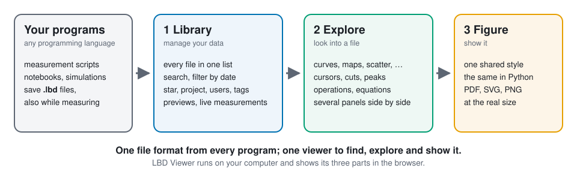
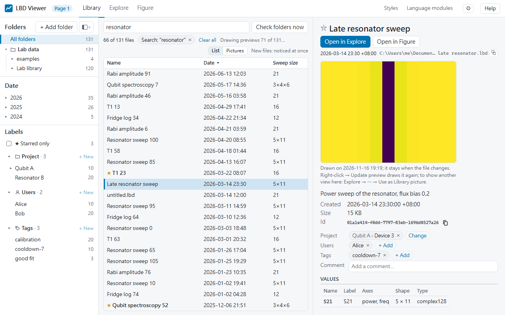
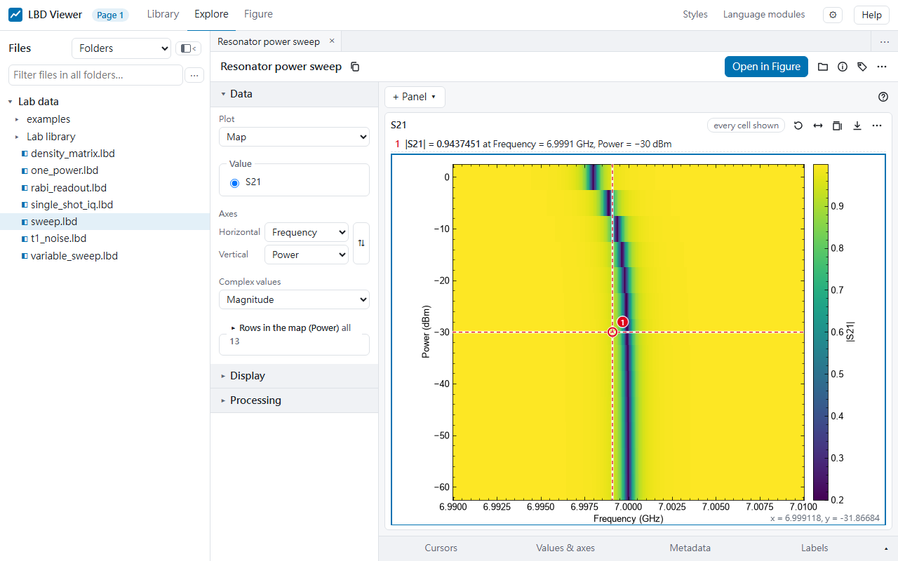
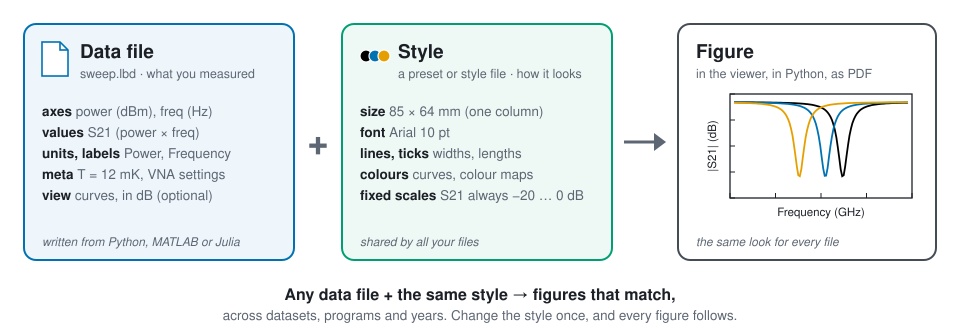

# LBD — Lab Data format and viewer

[](https://github.com/patrick-csliu/lbd/actions/workflows/tests.yml)
[](LICENSE)
[](https://patrick-csliu.github.io/lbd/)

**Your lab data in one format: write it from any programming language, find and label it in
the Library, explore it, and make figures that always match.**

Lab data comes from many programs, written in many programming languages: measurement
scripts, notebooks, simulations, instrument software. Over months it piles up in folders, on
several computers, each file in its own shape. Finding last week's measurement, looking into it,
and making a figure that matches last year's all take work. LBD gives all of it one home.

Coming from Labber? The Library and Explore do what its Log Browser and Log Viewer did.

**Documentation: [patrick-csliu.github.io/lbd](https://patrick-csliu.github.io/lbd/)**, with a
[quick start](https://patrick-csliu.github.io/lbd/getting-started/quickstart.html), examples
with their figures, and every feature of the viewer.

## How it works



Your programs save their data as **`.lbd` files** (plain HDF5 inside), with the small LBD module
for their programming language, also while they are still measuring. The same file reads back
identically in every [supported language](#2-install-the-module-for-your-language).

**LBD Viewer** runs on your computer and shows your data in the browser. It has three parts:

### 1. Library: manage your data

Every data file under your folders, in one list. Search names, values and metadata; filter by
folder, date, project, users and tags; star and comment. Each file shows a preview; a measurement
still being written shows how far it is. Labels are kept with the folder and written into the
file itself, so they travel with it, also to other computers. Copies of one measurement, copies
that differ and files that went missing are shown as such. [More](docs/viewer/library.md)



### 2. Explore: look into your data

Open a file and look into it interactively: curves, maps, scatter (also the complex I/Q plane),
histograms, matrices and bars. Cursors snap to the stored values; take cuts through a map, find
the maximum, minimum or a peak; apply operations (mean, normalize, d/dx, FFT, smoothing,
background, rotation, …) and equations; put several panels side by side, following each other's
zoom and cursors. A file being measured grows on screen. [More](docs/viewer/explore.md)



### 3. Figure: figures that always match

For a paper or a talk, LBD keeps **what you measured** and **how figures look** apart, and puts
them together only when it draws:



- **Data file (`.lbd`):** the axes you swept, the values you measured, units, labels and
  metadata. Optionally a saved *view*: what to plot by default.
- **Style:** size, fonts, line widths, ticks, colours, colour maps, and fixed scales per
  quantity. A named *preset* on your computer, or a `.lbd.json` style file to share.
- **Figure:** the Figure page and Python's `lbd.plot` draw the data file with the style, with the
  same code, on screen and in PDF, SVG or PNG at the real size.

Keep one style, and every figure matches: across datasets, programs and years. Change the style
once, and every figure follows; the data is never touched. [More](docs/getting-started/how-it-works.md)

## More features

- **Styles and figures:**
  - styles shaped like matplotlib (Figure → Axes → frame, axis, ticks, legend, …): presets shared
    with Python, style files (`*.lbd.json`) to keep with a paper, `.mplstyle` export;
  - fixed colour scales per quantity, for fair comparisons;
  - save a view (plot settings, style, annotations) into the file;
  - export PDF/SVG/PNG/JPG at an exact physical size.
- **The `.lbd` format:** plain HDF5 inside, so HDFView and h5py can also open it.
  - Axes with units and labels; N-D values; complex and boolean data; nested metadata.
  - Sweeps whose points differ per step (variable sweeps); labels and a unique id in the file.
  - The same array shape in every language: no transposing.
  - Version checks, so old tools never misread new files.
- **Language modules:** the same API in every supported language, today Python (`lbd`),
  MATLAB (`lbd.*`) and Julia (`LBD`), verified by a cross-language test matrix. More languages
  can be added ([Adding a language](docs/developers/adding-a-language.md)).
  - write while measuring (`lbd.Writer`): a crash keeps what was measured;
  - read only what you need from large files;
  - **`lbd.plot` for Python:** the viewer's styles and plot types in your own scripts, from memory
    or from the file.
- **LBD Viewer** runs on Windows, macOS and Linux: several browser tabs work together; light,
  dark or system theme; double-click any `.lbd` file to open it; Help works offline.

## Quick start

### 1. Install the viewer

One command per system installs (or upgrades) the latest release. It downloads the release's
installer, checks its SHA-256 checksum against the release's `SHA256SUMS`, and runs it:

| System | Command |
|---|---|
| Windows (PowerShell) | `irm https://github.com/patrick-csliu/lbd/releases/latest/download/install.ps1 \| iex` |
| Linux | `curl -fsSL https://github.com/patrick-csliu/lbd/releases/latest/download/install.sh \| sh` |
| macOS | `curl -fsSL https://github.com/patrick-csliu/lbd/releases/latest/download/install-macos.sh \| sh` |

Or download the installer from the [release page](https://github.com/patrick-csliu/lbd/releases/latest):
- **Windows:** run `LBD-Viewer-<version>-windows-x64-setup.exe`. No admin rights are needed.
- **Linux:** unpack the archive and run `./install.sh`.
- **macOS:** open the disk image and drag LBD Viewer to Applications; approve it once in
  System Settings → Privacy & Security (it isn't signed by a registered Apple developer).

Or build it yourself from the source: [Build LBD yourself](docs/developers/build-yourself.md).

After that, double-click any `.lbd` file. See [Install](docs/getting-started/install.md).

### 2. Install the module for your language

The viewer's **Language modules** page shows the exact command for your computer:

| Language | Install |
|---|---|
| Python | `pip install "<sdk>/python/lbd-<version>-py3-none-any.whl[plot]"` (`[plot]` adds `lbd.plot`) |
| MATLAB | double-click `<sdk>/matlab/LBD.mltbx` |
| Julia | `using Pkg; Pkg.develop(path="<sdk>/julia")` |

### 3. Write data

**Python**
```python
import numpy as np, lbd

f = np.linspace(4e9, 8e9, 401); p = np.arange(-40, 1, 4.0)
d = lbd.Dataset(title="Resonator power sweep")
d.add_axis("power", p, unit="dBm", label="Power")
d.add_axis("freq", f, unit="Hz", label="Frequency")
d.add_value("S21", np.exp(1j * np.outer(p, f) * 1e-10), axes=["power", "freq"])
d.meta["T_mK"] = 12
d.save("sweep.lbd")                      # lbd.load("sweep.lbd")["S21"].data -> (11, 401)
```

**MATLAB**
```matlab
f = linspace(4e9, 8e9, 401); p = -40:4:0;
d = lbd.Dataset("Resonator power sweep");
d.addAxis("power", p, Unit="dBm", Label="Power");
d.addAxis("freq", f, Unit="Hz", Label="Frequency");
d.addValue("S21", exp(1i * (p' * f) * 1e-10), ["power" "freq"]);
d.Meta.T_mK = 12;
d.save("sweep.lbd");                     % lbd.load("sweep.lbd").Values.S21.Data -> 11 x 401
```

**Julia**
```julia
using LBD
f = collect(range(4e9, 8e9, 401)); p = collect(-40.0:4:0)
d = LBD.Dataset("Resonator power sweep")
add_axis!(d, "power", p; unit="dBm", label="Power")
add_axis!(d, "freq", f; unit="Hz", label="Frequency")
add_value!(d, "S21", exp.(1im .* (p * f') .* 1e-10), ["power", "freq"])
d.meta["T_mK"] = 12
LBD.save("sweep.lbd", d)                 # size(LBD.load("sweep.lbd")["S21"].data) -> (11, 401)
```

### 4. Look at it

Double-click `sweep.lbd`: it opens in **Explore**. Or add its folder in the **Library** (Filters →
**+ Add folder**) and find it there. For a figure, **Open in Figure**, then export it or save the
view into the file.

Or plot it in Python with the same styles, from memory or from the file:

```python
import lbd.plot as lp
fig = lp.plot(d, "heatmap", "S21", complex="db", style="default")   # d: the Dataset above
lp.save(fig, "sweep.pdf")

import matplotlib.pyplot as plt
with lp.use("default"):                 # your own figure, same look
    fig, ax = plt.subplots()
    ax.plot(f, np.abs(d["S21"].data[0]))
    fig.savefig("my_figure.pdf")
```

## Documentation

The full documentation is a searchable website built from `docs/` with
[MkDocs](https://www.mkdocs.org/) and Material for MkDocs. It is online at
**[patrick-csliu.github.io/lbd](https://patrick-csliu.github.io/lbd/)**, for the latest release
(it is updated when a release is published). LBD Viewer ships a copy that works offline and
matches the installed version: use **Help** in the viewer's top bar. To build or preview it
from the repository:

```bash
uv sync --all-packages --group docs
uv run mkdocs serve              # live preview at http://127.0.0.1:8000
uv run mkdocs build --strict     # the site in site/ (open site/index.html)
```

The Python API reference and the style settings tables are generated from the code's
docstrings, so they always match the code. Good starting points (Markdown sources):

| | |
|---|---|
| [Quick start](docs/getting-started/quickstart.md) | Write a file, look at it, make matching figures, in each supported language. |
| [Concepts](docs/getting-started/concepts.md) | What a file contains, dimension order, types, names, versions. |
| [Install](docs/getting-started/install.md) | Viewer and modules: install, upgrade, uninstall. |
| [Examples](docs/examples/index.md) | Short scripts with their figures, explained step by step, and a "find an example by task" table. |
| [LBD Viewer](docs/viewer/index.md) | Every feature of the viewer. |
| [Styles](docs/styles/index.md) | How styles work, every setting, fixed scales, style files. |
| Languages | [Python](docs/python/files.md) · [lbd.plot](docs/python/plotting.md) · [MATLAB](docs/matlab.md) · [Julia](docs/julia.md) |
| [Developers](docs/developers/index.md) | Architecture, tests, HTTP API, extending, building releases. |
| [File format spec](spec/LBD-v1.md) | The exact HDF5 layout. |

## Project layout

```
spec/                 file format specification (the contract every language follows)
languages/            one folder per language, all with the same shape + a language.toml manifest
  python/               Python module `lbd`
  matlab/               MATLAB package `+lbd`
  julia/                Julia package `LBD`
  _template/            starting point for a new language (see languages/README.md)
viewer/               LBD Viewer
  src/lbd_viewer/       backend (Python package `lbd-viewer`, command `lbd-view`)
  web/                  user interface (React + TypeScript)
tests/crosslang/      every language reads every language's files (discovered from the manifests)
examples/             the script that makes the example .lbd files (examples/data, not in git)
  python/               example scripts + explanations (scripts/make_gallery.py builds docs/examples/)
packaging/            installer build files (PyInstaller, Inno Setup, Linux install scripts)
scripts/              test runner, version check, release build scripts
docs/                 documentation sources (MkDocs; mkdocs.yml at the root)
```

Adding a language means adding a folder under `languages/`; the tests, the version check, the
installer and the viewer pick it up from its `language.toml`. See
[Adding a language](docs/developers/adding-a-language.md).

## Development quick start

Keep the virtual environment outside synced folders, and exclude `viewer/web/node_modules` from
sync:

```bash
export UV_PROJECT_ENVIRONMENT=~/.venvs/lbd-dev
uv sync --all-packages --group docs            # the lbd module, the viewer, dev and docs tools
(cd viewer/web && npm ci && npm run build)     # the viewer's user interface
uv run python scripts/test_all.py              # every test suite, every language
uv run python examples/make_examples.py        # a few example files, into examples/data
uv run lbd-view --dev examples/data            # http://127.0.0.1:8765/?token=dev
```

The full test and release instructions are in the [developer guide](docs/developers/index.md).

## Requirements

| Part | Requirement |
|---|---|
| Viewer | 64-bit Windows 10/11, macOS 14+ (Apple Silicon or Intel), or a Linux desktop |
| Python module | Python 3.9+ (numpy, h5py; `[plot]` adds matplotlib, pydantic, platformdirs) |
| MATLAB module | MATLAB R2021b+ |
| Julia module | Julia 1.9+ (HDF5.jl, JSON3.jl) |

## License

MIT, see [LICENSE](LICENSE). Each language folder carries a copy, since a module can be
installed from its folder alone.
