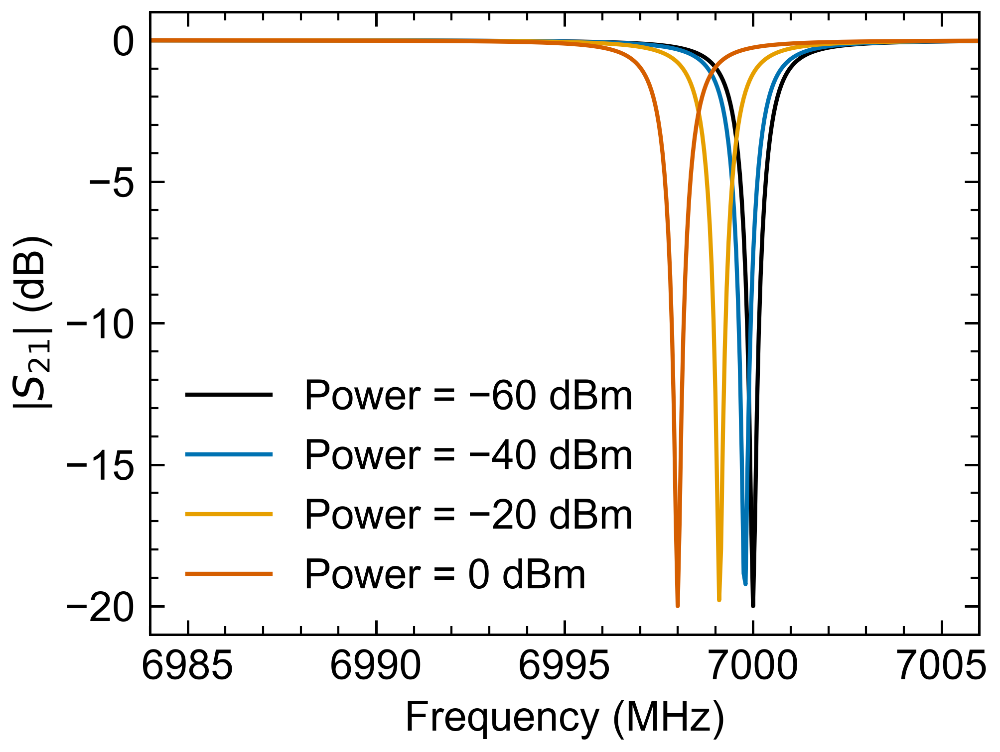
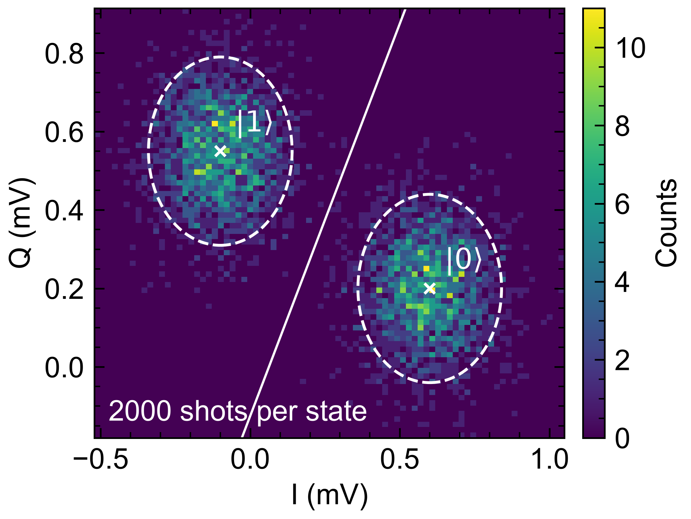
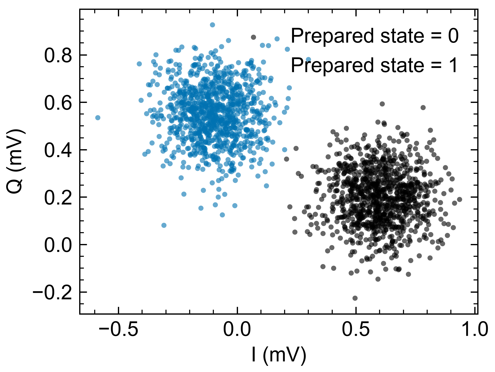
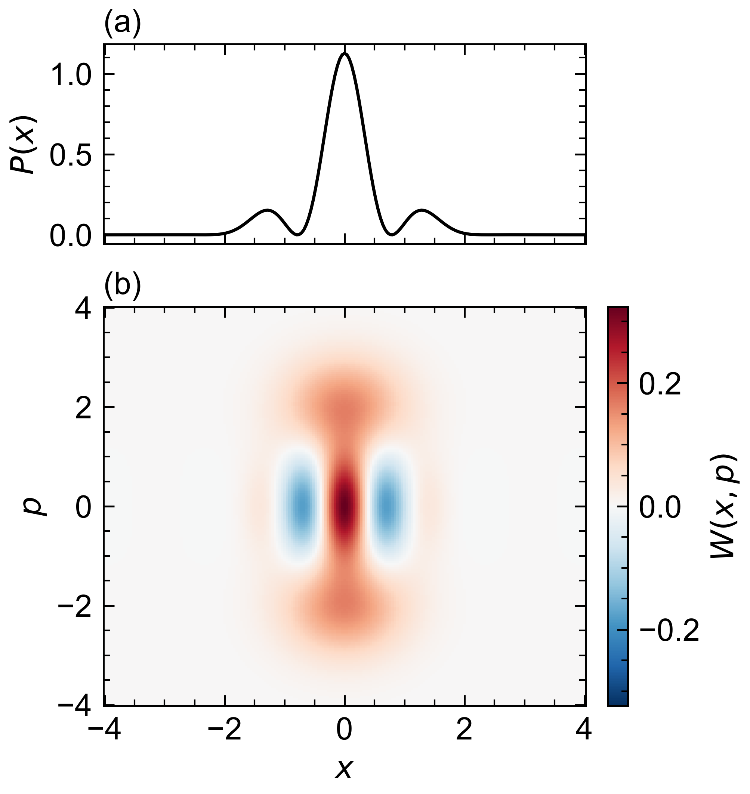
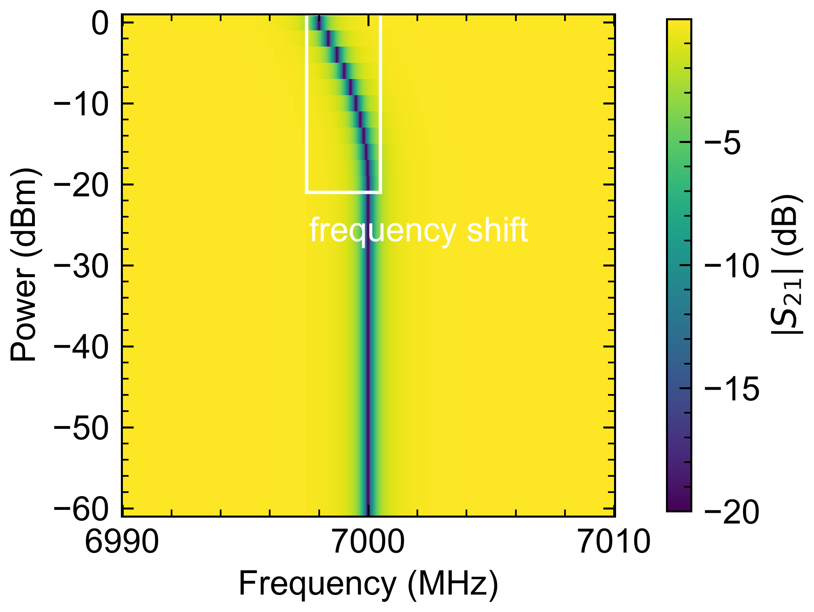
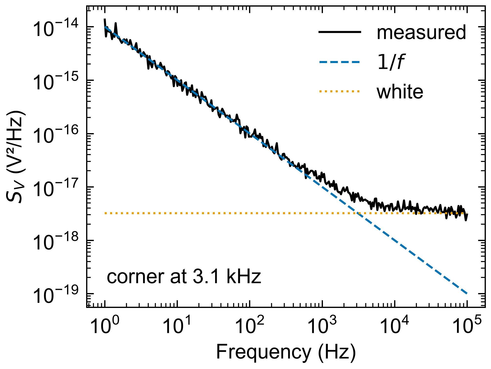
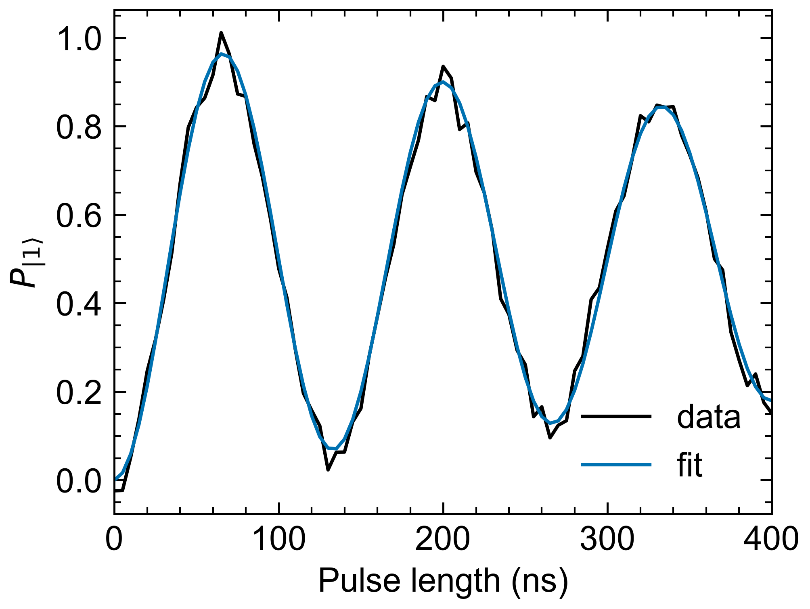
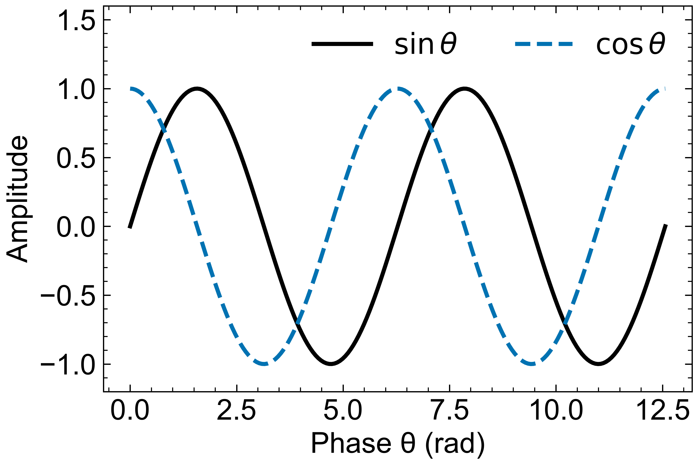

# Examples

Each example is one short Python script that you can copy and run. Every page shows the code,
what it makes, and how it works step by step, with links to the functions it uses.

## Find an example by task

| I want to … | Example | Functions |
|---|---|---|
| Save data to a file | [Curves](curves_resonator.md), [A box around a region, saved with the file](box_power_sweep.md) | [`lbd.Dataset`][lbd.Dataset], [`lbd.Dataset.save`][lbd.Dataset.save] |
| Record measurement settings (metadata) | [Curves](curves_resonator.md) | [`lbd.Dataset`][lbd.Dataset] |
| Read a file back (all of it, or only the header) | [Curves](curves_resonator.md) | [`lbd.load`][lbd.load], [`lbd.info`][lbd.info] |
| Plot a file like the viewer | [Curves](curves_resonator.md), [A box around a region, saved with the file](box_power_sweep.md) | [`lp.plot`][lbd.plot.plot] |
| Plot data in memory (without a file) | [Heat map](heatmap_single_shot.md), [Scatter](scatter_iq_readout.md), [Two panels with a shared axis](subplots_wigner.md) | [`lbd.Dataset`][lbd.Dataset], [`lp.plot`][lbd.plot.plot] |
| Plot numpy arrays quickly | [Quick look](quick_look.md) | [`lp.quick`][lbd.plot.quick] |
| Mark points, lines and regions (annotations) | [Heat map](heatmap_single_shot.md), [A box around a region, saved with the file](box_power_sweep.md) | [`lp.plot`][lbd.plot.plot] |
| Store the plot with the file (saved view) | [A box around a region, saved with the file](box_power_sweep.md) | [`lbd.set_plot`][lbd.set_plot] |
| Export PDF, SVG and PNG | [A box around a region, saved with the file](box_power_sweep.md) | [`lp.save`][lbd.plot.save] |
| Fix a unit prefix (MHz, mV, …) | [Curves](curves_resonator.md), [Heat map](heatmap_single_shot.md), [Scatter](scatter_iq_readout.md), [A box around a region, saved with the file](box_power_sweep.md) | [`lp.prefix`][lbd.plot.prefix] |
| Override the style for one figure | [Curves](curves_resonator.md), [Scatter](scatter_iq_readout.md), [Two panels with a shared axis](subplots_wigner.md) | [`lp.plot`][lbd.plot.plot], [`lp.load_style`][lbd.plot.load_style] |
| Your own matplotlib figure in the house style | [Two panels with a shared axis](subplots_wigner.md), [Log scale](logscale_noise.md) | [`lp.use`][lbd.plot.use], [`lp.axis_label`][lbd.plot.axis_label], [`lp.save`][lbd.plot.save] |
| Combine panels with a shared axis | [Two panels with a shared axis](subplots_wigner.md) | [`lp.subplots`][lbd.plot.subplots] |
| Colour points by group with a legend | [Scatter](scatter_iq_readout.md) | [`lp.plot`][lbd.plot.plot] |
| Log axes | [Log scale](logscale_noise.md) | [`lp.use`][lbd.plot.use] |
| Make and share a style (preset, style file, .mplstyle) | [Styles](styles_and_presets.md) | [`lp.PresetStore`][lbd.plot.PresetStore], [`lp.Style`][lbd.plot.Style] |

## Gallery

-   

    **[Curves: a resonator measured at several powers](curves_resonator.md)**

    save data and metadata (instrument settings) in an .lbd file, read the header back, plot curves.

-   

    **[Heat map: single-shot qubit readout with the two states marked](heatmap_single_shot.md)**

    annotations: an Axes method with args and kwargs, a patch, text at a fixed place in the plot.

-   

    **[Scatter: single-shot readout in the I/Q plane](scatter_iq_readout.md)**

    plot a Dataset in memory; colour points by an axis (a legend for a short axis); override the style for one figure.

-   

    **[Two panels with a shared axis: a Wigner function and its projection](subplots_wigner.md)**

    lp.subplots with a shared axis; lp.plot into one panel (ax=), your own matplotlib code in the other.

-   

    **[A box around a region, saved with the file](box_power_sweep.md)**

    store the plot with the file (lbd.set_plot); redraw it from the file; export PDF, SVG and PNG.

-   

    **[Log scale: a noise spectrum in your own matplotlib code](logscale_noise.md)**

    lp.use for the style, lp.axis_label for "Name (unit)", lp.prefix for a readable number, lp.save.

-   

    **[Quick look: plot numpy arrays in one call](quick_look.md)**

    lp.quick with named curves (a dict), labels and units; base units get readable prefixes.

-   

    **[Styles: make a preset once, use it everywhere](styles_and_presets.md)**

    list and load styles, change settings, store a preset, a .lbd.json style file, an .mplstyle file.

