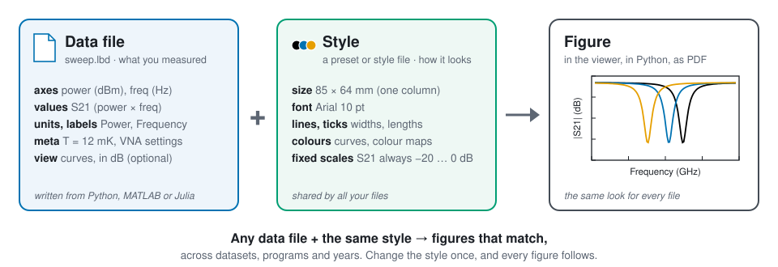

# How LBD works

## The problem

Lab data comes from many programs, written in many programming languages: measurement
scripts, notebooks, simulations, instrument software. Each one plots in its own way, with its
own sizes, fonts, colours and colour ranges. So figures from two programs, or from last year and
this year, never quite match. Comparing them means plotting everything again by hand, and a thesis or paper with dozens
of figures takes a lot of fiddling to look consistent.

## The idea: keep the data and the look apart

LBD keeps two things separate, and puts them together only when a figure is drawn.

**The data file (`.lbd`): what you measured.**

- The axes you swept (power, frequency, time…) and the values you measured on them, with
  units and labels.
- Metadata: anything else worth keeping, such as the temperature or instrument settings.
- Optionally, a saved **view**: *what* to plot by default (which value, curves or heat map, in
  dB or not). It says nothing about how the figure looks.
- Your program writes it with the small LBD module for its programming language
  ([supported languages](install.md#language-modules)). The same file reads back the same in
  every language. Inside it is plain HDF5.

**The style: how figures look.**

- Size, fonts, line widths, ticks, colours, colour maps, and **fixed scales per quantity**
  (e.g. `S21` in dB always from −20 to 0 dB).
- A **preset** is a named style on your computer, shared by LBD Viewer and Python. A **style
  file** (`*.lbd.json`) is the same thing as a file, to keep next to a paper's data or send to
  a colleague.

**The figure: the two put together.** LBD Viewer and Python's `lbd.plot` draw the data file
with the style, using the same matplotlib code. So the same file and the same style give the
same figure, on screen and exported to PDF, SVG or PNG at its real size.

## Why it's useful

- **Figures that match.** Every data file drawn with the same style looks the same. A sweep
  saved by a MATLAB script last year sits next to one from a Python notebook today, ready to
  compare.
- **Comparable colours and scales.** With fixed scales per quantity, the same colour means
  the same value in every heat map, and the same quantity always gets the same unit.
- **Change the look once.** Edit the preset, for example a larger font for slides, and every
  figure follows. No plotting scripts to rerun.
- **One look everywhere.** The viewer and `lbd.plot` draw identically, and your own matplotlib
  figures can use the same style (`lbd.plot.use`, see
  [Consistent figures in your own code](../styles/consistent-figures.md)).
- **Ready for print.** Figures export at their real size with fonts embedded. The built-in
  `default` style follows the figure rules of APS and AIP journals.
- **The data stays untouched.** A style never changes data. Saving a view only adds the plot
  settings to the file.
- **Easy to share.** Send the data files and the style file; the receiver sees the same figures.

## How the pieces combine

When a figure is drawn, the settings are applied in this order; a later one wins:

1. **The style:** the preset the data file names (if it exists on this computer), otherwise
   your default preset, or a style file you chose.
2. **The data file's own style changes**, if it has any, e.g. "this figure is 120 mm wide".
3. **What you changed in the viewer** and haven't saved yet.

So the shared look stays in one place (the style), and an exception for one figure is stored
with that figure's data.

## Next

- [Install](install.md) LBD Viewer and the module for your language.
- The [Quick start](quickstart.md): write a file, plot it, save a view, export, in ten minutes.
- [Concepts](concepts.md): exactly what a data file holds.
- [How styles work](../styles/index.md): every style setting.
