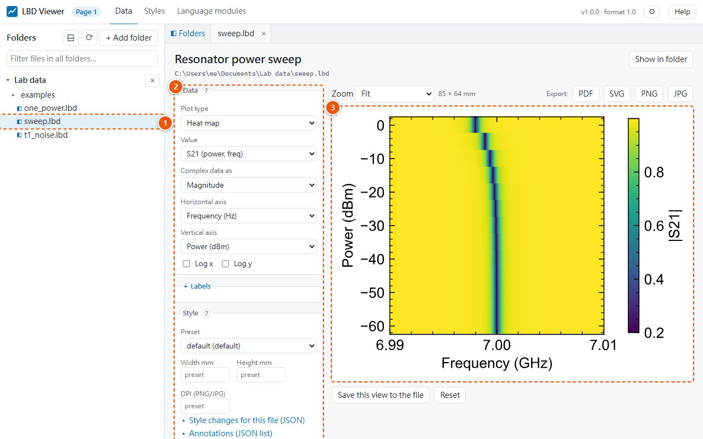
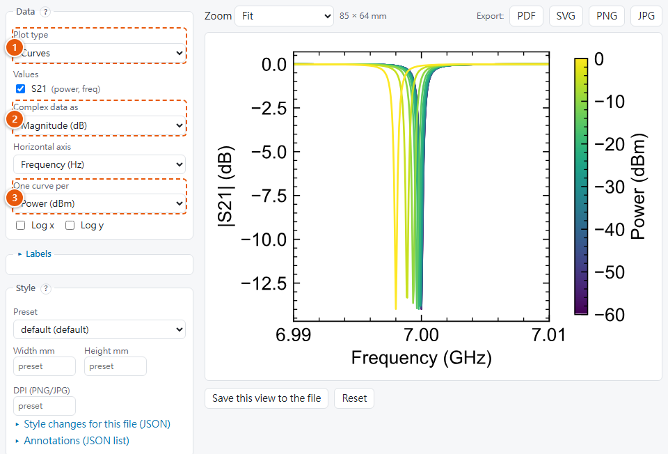
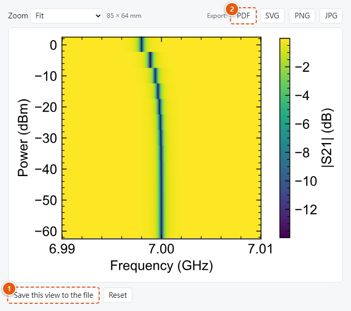

# Quick start

In ten minutes you will:

1. **write** a measurement to an `.lbd` file from Python, MATLAB or Julia;
2. **look at it** in LBD Viewer and change how it's plotted;
3. **save** that view in the file and **export** a figure for a paper;
4. make the **same figure from Python**.

Before you start, [install](install.md) LBD Viewer and the module for your language.

## 1. Write a file

An `.lbd` file holds a measurement as:

- **axes:** what you swept, here the drive power and the frequency;
- **values:** what you measured on those axes, here the resonator's transmission `S21` at every
  power and frequency.

Pick your language. The tabs on every page switch together.

=== "Python"

    ```python
    import numpy as np
    import lbd

    f = np.linspace(6.99e9, 7.01e9, 401)
    p = np.arange(-60, 1, 5.0)
    f0 = 7e9 - 2e6 * 10 ** (p / 20)                    # the resonance moves down at high power
    s21 = 1 - 0.8 / (1 + 2j * (f[None, :] - f0[:, None]) / 0.6e6)

    d = lbd.Dataset(title="Resonator power sweep")
    d.add_axis("power", p, unit="dBm", label="Power")
    d.add_axis("freq", f, unit="Hz", label="Frequency")
    d.add_value("S21", s21, axes=["power", "freq"])    # shape (13, 401) = (power, freq)
    d.meta["T_mK"] = 12
    d.save("sweep.lbd")
    ```

=== "MATLAB"

    ```matlab
    f = linspace(6.99e9, 7.01e9, 401);
    p = -60:5:0;
    f0 = 7e9 - 2e6 * 10.^(p.' / 20);                  % the resonance moves down at high power
    s21 = 1 - 0.8 ./ (1 + 2i * (f - f0) / 0.6e6);

    d = lbd.Dataset("Resonator power sweep");
    d.addAxis("power", p, Unit="dBm", Label="Power");
    d.addAxis("freq", f, Unit="Hz", Label="Frequency");
    d.addValue("S21", s21, ["power" "freq"]);       % size 13 x 401 = (power, freq)
    d.Meta.T_mK = 12;
    d.save("sweep.lbd");
    ```

=== "Julia"

    ```julia
    using LBD

    f = collect(range(6.99e9, 7.01e9, 401))
    p = collect(-60.0:5:0)
    f0 = 7e9 .- 2e6 .* 10 .^ (p ./ 20)               # the resonance moves down at high power
    s21 = 1 .- 0.8 ./ (1 .+ 2im .* (f' .- f0) ./ 0.6e6)

    d = Dataset("Resonator power sweep")
    add_axis!(d, "power", p; unit="dBm", label="Power")
    add_axis!(d, "freq", f; unit="Hz", label="Frequency")
    add_value!(d, "S21", s21, ["power", "freq"])    # size (13, 401) = (power, freq)
    d.meta["T_mK"] = 12
    LBD.save("sweep.lbd", d)
    ```

The axes are listed in the order of your array's dimensions, so the same file reads back with
the same shape in all three languages. `meta` holds anything else worth keeping, here the
temperature. See [Concepts](concepts.md) for types, names and units.

## 2. Open it

**Double-click `sweep.lbd`.** LBD Viewer opens it in your browser:



1. **The file**, in the folder panel. To see all the files of a project, use **+ Add folder**
   ([Folders and files](../viewer/folders-and-files.md)).
2. **The plot controls:** what to plot and how.
3. **The figure:** `S21` has two swept axes, so the viewer starts with a heat map, |S21| over
   power and frequency. The dark line is the resonance, moving left at high power.

Units are scaled for you: the frequency axis reads *Frequency (GHz)*.

## 3. Change the plot



1. **Plot type** → *Curves*.
2. **Complex data as** → *Magnitude (dB)*.
3. **One curve per** → *Power (dBm)*: one curve per power, coloured from low (dark) to high
   (yellow) power.

To look at one power only, choose **One curve per** → *— (single curve)*. A slider then picks
the power, or you type it, e.g. `-20`. Every control is explained in
[Plotting](../viewer/plotting.md).

## 4. Save the view and export

{ width="560" }

1. **Save this view to the file** stores your plot settings inside `sweep.lbd`. From now on it
   opens like this, for anyone, on any computer. The data is never changed.
2. **Export: PDF** saves the figure at its real size: 85 mm × 64 mm, 10 pt text, fonts
   embedded, ready for a column of an APS or AIP journal. PNG, SVG and JPG work the same way.

More in [Saving views and exporting](../viewer/saving-and-exporting.md).

## 5. Make every figure match

The size, fonts, frame, ticks and colours come from a **style preset**. To change them for all
your figures, open **Styles** in the viewer's top bar, create a preset (for example *thesis*)
and click **Make default**. Every figure in the viewer, and in Python, then uses it
([Styles page](../viewer/styles-page.md), [How styles work](../styles/index.md)).

## 6. The same figure from Python

`lbd.plot` draws exactly what the viewer draws, with the same style:

```python
import lbd
import lbd.plot as lp

d = lbd.load("sweep.lbd")
fig = lp.plot(d)                      # the saved view (or the automatic one), as in the viewer
lp.save(fig, "sweep.pdf")
```

For a figure of your own, use the same style with matplotlib:

```python
import matplotlib.pyplot as plt
import lbd
import lbd.plot as lp

d = lbd.load("sweep.lbd")
with lp.use("default"):               # your preset's name, or a .lbd.json style file
    fig, ax = plt.subplots()
    f_ghz, f_unit = lp.prefix(d.axes["freq"].data, "Hz")
    ax.plot(f_ghz, abs(d["S21"].data[-1]))
    ax.set_xlabel(lp.axis_label("Frequency", f_unit))
    ax.set_ylabel(lp.axis_label("|S21|", ""))
    fig.savefig("my_figure.pdf")
```

## Next

- [Concepts](concepts.md): what exactly a file holds.
- [LBD Viewer](../viewer/index.md): every part of the window, every control and page.
- [Styles and figures](../styles/index.md): every setting, fixed colour scales per quantity,
  unit prefixes.
- The reference for your language: [Python](../python/files.md) · [MATLAB](../matlab.md) ·
  [Julia](../julia.md).
