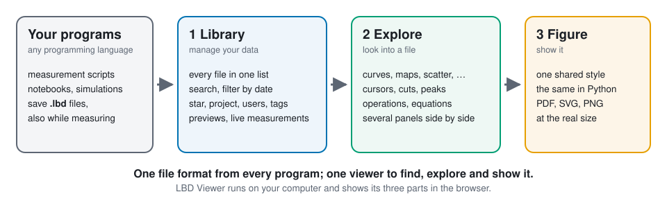
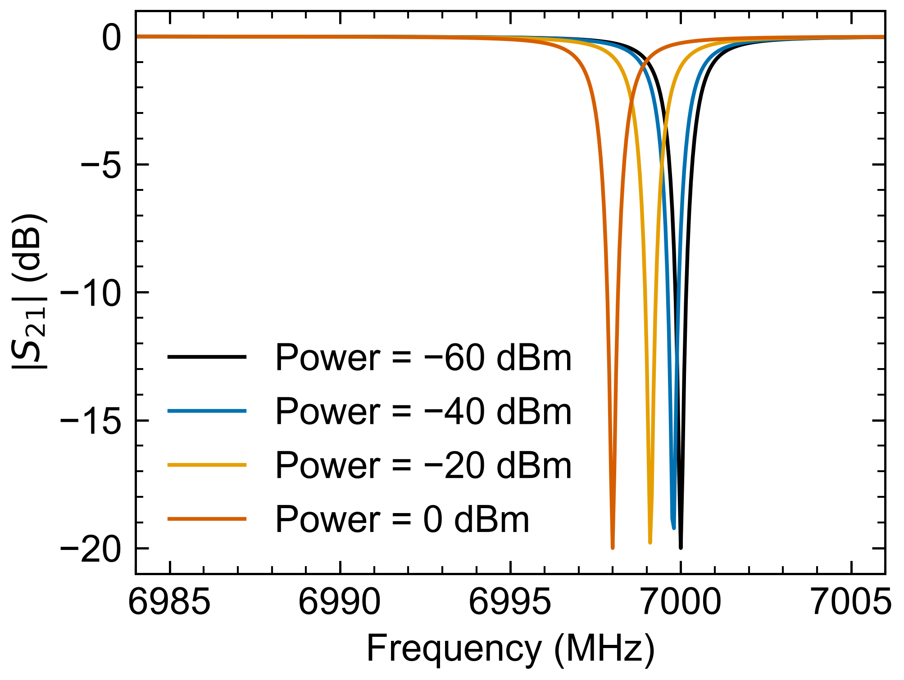
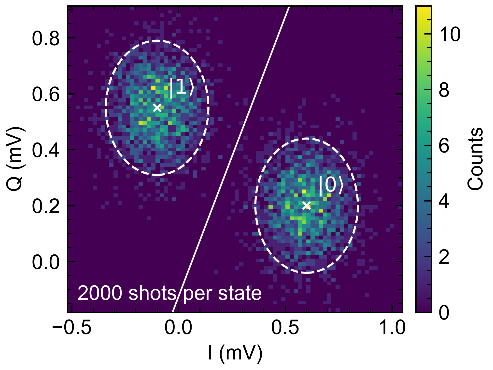
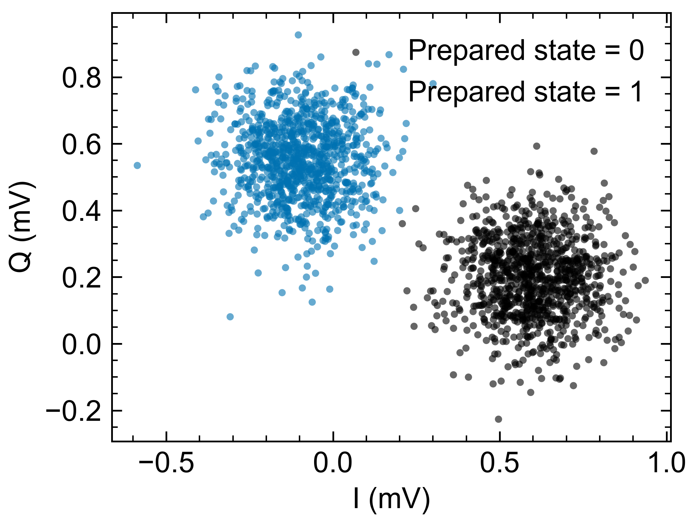
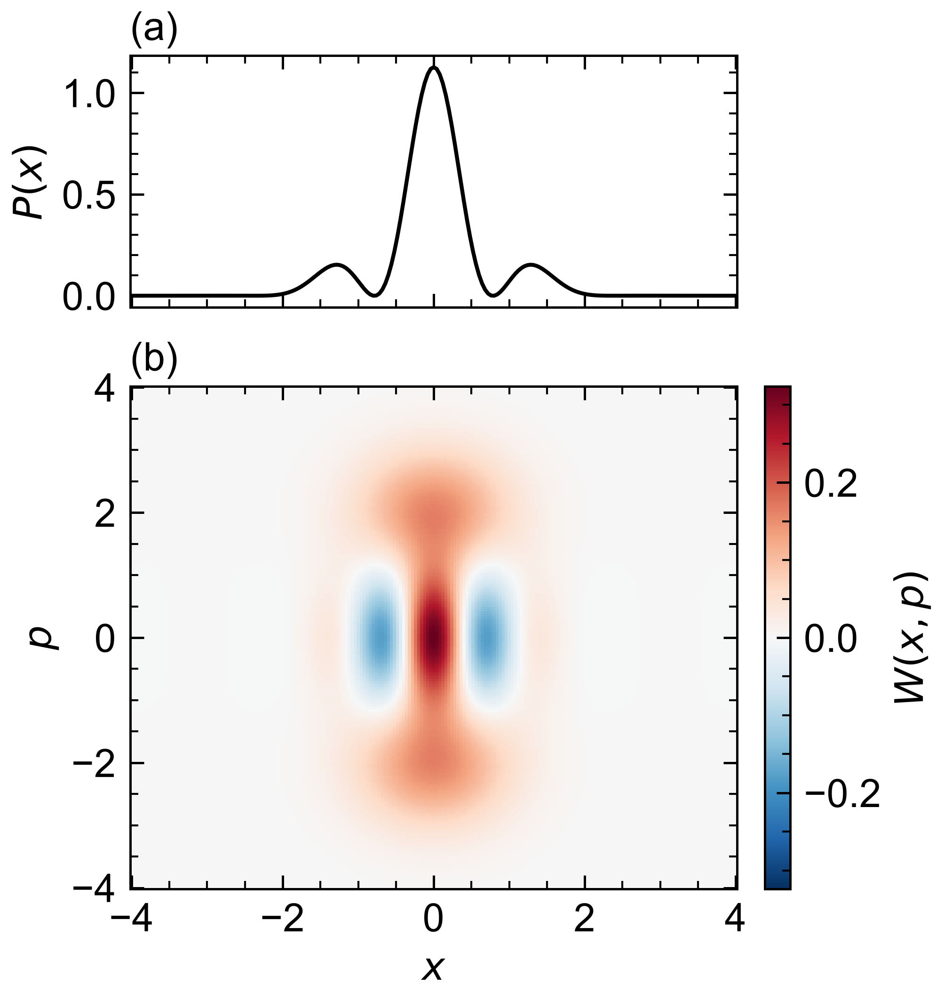

---
hide:
  - navigation
  - toc
---

# LBD

**Your lab data in one format: write it from any programming language, find and label it in
the Library, explore it, and make figures that always match.**

Save measurements from your own programs, in any supported programming language, as `.lbd`
files, also while they are being measured. LBD Viewer shows them on three pages:

- **Library**: every data file under your folders in one list, with search, filters, labels and a
  preview of each.
- **Explore**: look into a file with cursors, cuts, operations and equations, in several panels.
- **Figure**: figures that look the same for every dataset, every program and every year: the same
  size, fonts, line widths, colours and colour scales.

[How LBD works :octicons-arrow-right-24:](getting-started/how-it-works.md)

-   :material-rocket-launch:{ .lg .middle } **Get started**

    ---

    Install the viewer and a language module, then take the ten-minute tour.

    [:octicons-arrow-right-24: Install](getting-started/install.md) ·
    [Quick start](getting-started/quickstart.md)

-   :material-bookshelf:{ .lg .middle } **Library**

    ---

    Every data file under your folders in one list: search, filter by date, project, users and
    tags, star and comment, a preview of each, measurements still being written.

    [:octicons-arrow-right-24: Library](viewer/library.md)

-   :material-magnify-scan:{ .lg .middle } **Explore**

    ---

    Curves, maps, scatter, histograms and more; cursors on the stored values, cuts, peaks,
    operations and equations, several panels side by side.

    [:octicons-arrow-right-24: Explore](viewer/explore.md)

-   :material-chart-bell-curve:{ .lg .middle } **Figure**

    ---

    The figure for your paper: plot, save a view into the file, export PDF, SVG or PNG at the
    real size.

    [:octicons-arrow-right-24: Figure](viewer/plotting.md) ·
    [Viewer guide](viewer/index.md)

-   :material-record-rec:{ .lg .middle } **While measuring**

    ---

    Write a file as you measure, and watch it grow in the viewer; a crash keeps what was
    measured. Large files are read part by part.

    [:octicons-arrow-right-24: Writing while measuring](getting-started/writing-while-measuring.md) ·
    [Large files](getting-started/large-files.md)

-   :material-palette-swatch:{ .lg .middle } **Styles**

    ---

    Every visual setting in one style, shaped like matplotlib's Figure → Axes tree. Presets,
    style files, fixed colour scales per quantity.

    [:octicons-arrow-right-24: How styles work](styles/index.md) ·
    [All settings](styles/settings.md)

-   :material-language-python:{ .lg .middle } **Python**

    ---

    Write and read files with `lbd`; draw your own matplotlib figures in the same style with
    `lbd.plot`.

    [:octicons-arrow-right-24: Files](python/files.md) ·
    [Plotting](python/plotting.md) ·
    [API reference](reference/python/lbd.md)

-   :material-math-integral-box:{ .lg .middle } **Other languages**

    ---

    The same files, with the same dimension order, in every supported language.

    [:octicons-arrow-right-24: MATLAB](matlab.md) ·
    [Julia](julia.md) ·
    [Adding a language](developers/adding-a-language.md)

-   :material-file-tree:{ .lg .middle } **File format**

    ---

    Plain HDF5 inside, with a short specification every implementation follows.

    [:octicons-arrow-right-24: Concepts](getting-started/concepts.md) ·
    [Specification](format.md)

-   :material-image-multiple:{ .lg .middle } **Examples**

    ---

    Short scripts with their figures: save data and settings, annotations, your own figures,
    styles. Each explained step by step.

    [:octicons-arrow-right-24: Gallery](examples/index.md#gallery) ·
    [Find an example by task](examples/index.md#find-an-example-by-task)

## Examples

-   

    **[Curves](examples/curves_resonator.md)**: save data and settings, plot curves

-   

    **[Heat map](examples/heatmap_single_shot.md)**: mark points, lines and regions

-   

    **[Scatter](examples/scatter_iq_readout.md)**: the I/Q plane, a colour per state

-   

    **[Two panels](examples/subplots_wigner.md)**: your own plot next to the tool's

[All examples :octicons-arrow-right-24:](examples/index.md)

## Start here

| I want to… | Read |
|---|---|
| understand the idea | [How LBD works](getting-started/how-it-works.md). |
| look at data files | [Install the viewer](getting-started/install.md#lbd-viewer-on-windows), then the [viewer guide](viewer/index.md). |
| find my measurements again | The [Library](viewer/library.md): search, filters and labels. |
| look into a measurement | [Explore](viewer/explore.md): cursors, cuts, operations, equations, panels. |
| save data while measuring | [Writing while measuring](getting-started/writing-while-measuring.md). |
| work with files larger than memory | [Large files](getting-started/large-files.md). |
| use LBD on several computers | [Several computers](getting-started/several-computers.md). |
| make my programs write `.lbd` files | [Install the module](getting-started/install.md#language-modules), the [quick start](getting-started/quickstart.md) and [Concepts](getting-started/concepts.md). |
| make every figure of a paper or thesis match | [Consistent figures in your own code](styles/consistent-figures.md) and [fixed scales per quantity](styles/scales-and-units.md#fixed-scales-per-quantity). |
| work on LBD itself | The [developer guide](developers/index.md). |
| add support for another language | [Adding a language](developers/adding-a-language.md). |

!!! tip "This documentation works offline"
    LBD Viewer ships a copy of this site: use **Help** in the viewer's top bar. Search works
    without a network connection too.
