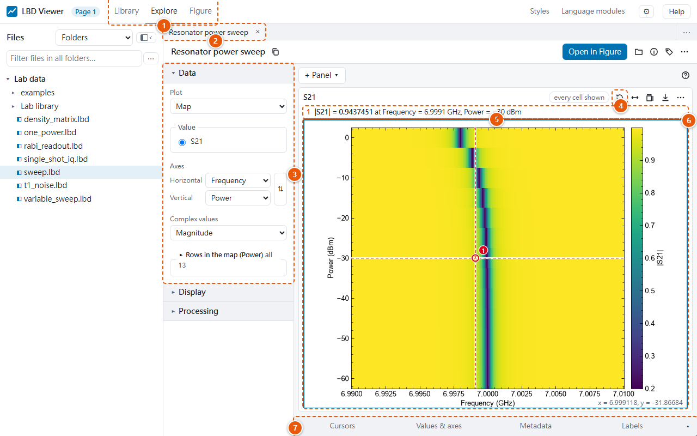
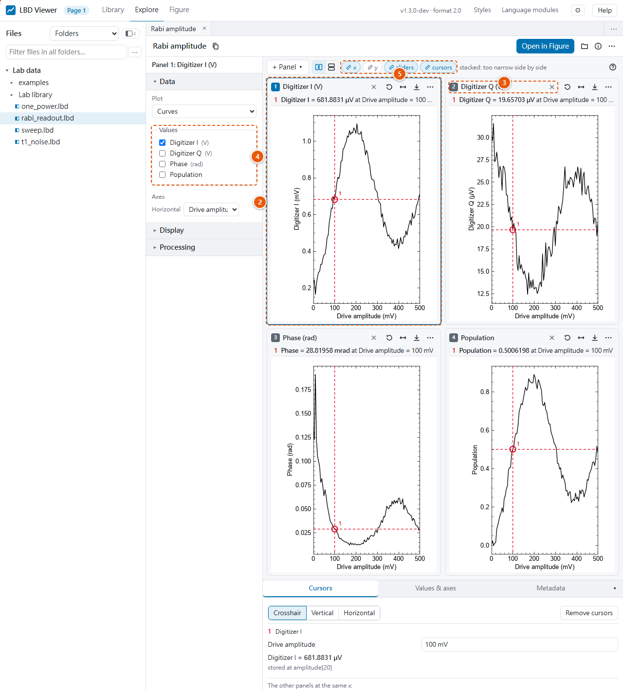
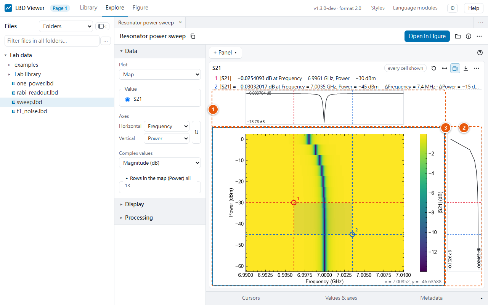
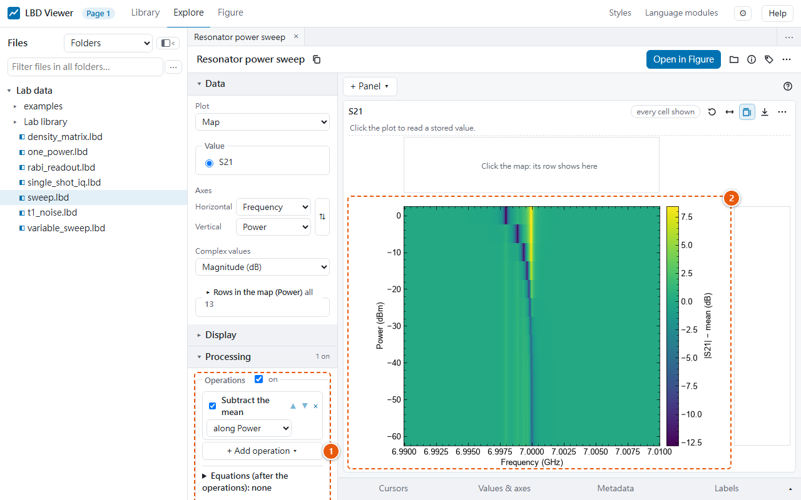
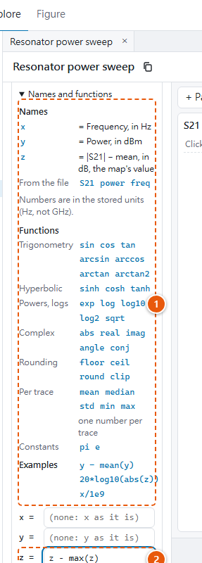

# Explore

**Explore** is where you look at data: zoom in, read exact values, step through traces, switch
between curves and maps. It is the viewer's default workspace: double-clicking a data file
opens it here. For a figure to export, use **Figure** (one click away, see below).



1. **Workspaces:** **Library** (find files), **Explore** (look at data) and **Figure** (make
   figures). Each has its own tabs; a file can be open in Explore and in Figure at once.
2. **Tabs** of the files open in Explore, by title (the file name is in the tooltip). A single
   click on a file shows it in a *preview* tab (in italics), which the next single click
   replaces; a double-click keeps it open. Right-click a tab to close it, open it in Figure or in
   a new browser tab; **⋯** at the end lists every tab; ← → move between them.
3. **The controls**, in three folding sections: **Data** (curves or a map, the values, the axes,
   one curve per …, complex values, a [slider](#sync-panels-that-follow-each-other) for each
   other dimension, which traces),
   **Display** (scales, colours, what a pixel shows when it stands for several cells) and
   **Processing** (operations and equations).
4. **The panel's toolbar**: its name, then **⟲** reset the view, **⇔** type the limits,
   **✂** cuts (maps), **⤓** data (save as CSV, copy the picture) and **⋯** (mouse and keys,
   duplicate or remove the panel). Each icon says what it does when you point at it.
5. **The cursors' values**, under the panel's title: a line per cursor, with the differences on
   cursor 2's line (see [Reading values](#reading-values)).
6. **The plot.** Zoom, pan and click on it, see [Moving around](#moving-around).
7. **The inspector:** **Cursors** (all the numbers, typed positions, Max / Min / Peak, Remove cursors),
   **Values & axes** (the file's tables) and **Metadata** (with a filter). **ⓘ** at the top
   opens it on the file's values and axes.

The header holds the title, the path (**⧉** copies it), **Open in Figure**, **📂** show in folder,
**ⓘ** file info and **⋯** (**Use as Library picture**, **Forget this view**). Click **?** above
the panels (or press **?** on a plot) for every mouse action and key.

**Any window size.** Explore fills the window and the page itself never scrolls: the controls,
the panels and the inspector each scroll on their own, so changing a setting or reading a value
never moves the plot.

| Explore's width | Controls | Panels | Inspector |
|---|---|---|---|
| 1500 px or more | a column on the left | the middle | a column on the right |
| 1100–1500 px | a column | the middle | a strip under the panels |
| 900–1100 px | a column | the middle | a tab row under the panels; click a tab to open it |
| below 900 px | a drawer: **⚙** above the panels | the whole width | a tab row; opens as a sheet |

Panels side by side that would be narrower than 450 px are stacked instead, for that size only
(the panel bar says "stacked: too narrow side by side"); a wider window puts them back.

**Resizing:** drag the inner edge of the controls column, or of the inspector (its left edge when
it is on the right, its top edge when it is a strip below), to make it wider or taller; the
panels take the rest. **Double-click** the edge to go back to the default size. The sizes are
remembered in this browser.

## Moving around

| Do | What happens |
|---|---|
| Turn the mouse wheel | Zooms in or out around the mouse. **Shift**: only horizontally; **Alt**: only vertically. |
| Drag with the left button | Zooms to the box you drew. A flat box zooms one axis only. |
| Drag with the right or middle button | Moves the view. |
| Double-click | Shows all the data again (also **⟲ Reset view**). |
| Click | Puts cursor 1 on the nearest stored point (curves) or on the cell (maps), see [Reading values](#reading-values). |
| Right-click | A menu: cursors, Max, Min, Peak, cuts, show everything. |
| **⇔ Limits**, then type in **Horizontal** / **Vertical** *from … to* | Shows exactly that range. Empty boxes mean "to the end of the data". |
| **Esc** | Closes what is open (help, limits); with nothing open, removes the cursors (**Undo** in the message). |

Every picture is complete: its axes always match its data. While you zoom or pan, the data is
drawn at half resolution, which is faster; as soon as the mouse rests, the sharp picture follows.
Pictures are drawn by the same engine as the figures, so Explore and Figure look alike.

## Choosing traces

Under the controls, a list shows each position of the axis that makes the traces: **Curves
shown** (one curve per …) or **Rows in the map** (the map's vertical axis). While every trace
is shown, the list is folded under its title ("all 4001"); click the title to open it.

- Click a value: only that trace. **Shift**-click: every trace from the last one you clicked to
  this one. **Ctrl**-click (**⌘** on macOS) or the box: add or remove one.
- **All** and **None** at the top.

In a map, rows you leave out stay **empty, in their place**: the vertical axis always tells the
truth. (Packing the chosen rows together would move them.)

## Several values: panels



A measurement often records several values at each point: I, Q and a population, or an
amplitude and a phase. (Labber calls them *log channels*; in LBD they are **values**, and what
was swept, Labber's *step channels*, are the **axes**.) A file with several values opens in
Explore with **one panel per value**, side by side: up to four at first, up to six in all. A file
with one value shows one plot, as always. Single numbers never get a panel.

1. **+ Panel ▾** adds a panel for a value. The two layout icons arrange the panels **side by
   side** or **stacked**; their grid follows from how many there are.
2. **The active panel** is outlined: click anywhere in a panel (or press **1** … **6**). The side
   panel shows its controls ("Panel 2: Q"): what you change there changes that panel only. Each
   panel has its own plot type, values, operations, equations, scales and colours.
3. **A panel's title bar**: drag it to move the panel; **×** removes it; right-click it (or **⋯**) to
   **Duplicate** it (the same value twice, for example with and without an operation, or at two
   slider positions).
4. **Values** in the side panel: tick one to add it to the active panel, drag one onto a panel
   to add it there (or onto the bar above the panels for a new panel), right-click one for
   **Show in a new panel** or **Show only this value here**.
5. **Sync** above the panels, four toggles (**x**, **y**, **sliders**, **cursors**): which panels
   follow each other, explained [below](#sync-panels-that-follow-each-other).

### Sync: panels that follow each other

Each toggle links one thing between the panels that have it in common, and turning one on lines
the other panels up with the active one at once:

| Toggle | Links | Between panels with |
|---|---|---|
| **x** (on) | zoom and pan along the horizontal axis | the same horizontal axis (label and unit) |
| **y** (off) | zoom and pan along the vertical axis | the same vertical unit (curves) or the same vertical axis (maps) |
| **sliders** (on) | which step of an axis that isn't drawn is shown | a slider of the same axis |
| **cursors** (on) | the cursors' positions (each panel reads its own value there) | the same horizontal axis |

**x and y**, for example four panels against time, two pressures (mbar) and two temperatures
(K):

- With **x** on, a zoom or pan in any panel moves all four horizontally (they share Time); each
  keeps its own vertical range. Showing everything shows the time range of all four.
- With **y** on, the two pressure panels zoom together vertically, and so do the two temperature
  panels; a pressure panel never takes a temperature range. With only y on, nothing follows
  horizontally.
- Panels are matched by the axis as drawn, unit prefix included: a panel in kPa and one in Pa
  don't follow each other, nor does one whose x an equation or an FFT changed. Its title bar says
  so ("x not synced: Power (dBm), not Frequency (GHz)").
- On curves, y matches by unit only: two different quantities in the same unit (a sample and a
  fridge temperature, both K) zoom together.

**sliders.** A slider chooses the step of an axis that isn't drawn: a measurement over power,
flux and frequency shown as a flux × frequency map has a **power** slider, and the plot shows
one power at a time. With **sliders** on, panels with a slider of the same axis show the same
step: with S21 in one panel and S11 in another, moving the power slider of either moves both, so
the two are always compared at the same power. They follow by **stored step** (the 5th power is
the 5th power in the others); a panel without that slider isn't touched. Switch it off to show,
say, the ground and the excited state side by side in two panels of the same value.

**cursors** are apart from **x**: zoom four temperatures to one time range but put a cursor on
each one's own drop (x on, cursors off), or read every panel at one time while each keeps its
own zoom (x off, cursors on).

**One cursor for all:** while the cursors are synchronized, a click in a panel puts the cursor at that x in
every panel with the same horizontal axis; each panel puts it on its own data (its own trace, or
in a map its own row; maps with the same vertical axis too, such as two values of one file, use
the same row). The panel you click in leads. The inspector's **Cursors** tab lists the other
panels' values at the cursor ("The other panels at the same x"), with the difference between
two cursors. **Max**, **Min** and **Peak** search the active panel and move every cursor.

**Two units in one panel:** a value with another unit than the panel's first one goes on a
**right-hand axis**, labelled in its colour; its curves are dashed. The cursor reads each curve in
its own unit. Both axes zoom together. A panel shows two units at most: a value with a third
can't be ticked; show it in another panel. Operations and equations make one quantity of the
values (without a unit), so with them the panel has one axis.

## Named positions and data points

- An axis with **elements** (format 1.2, e.g. a qubit prepared in `ground` or `excited`) shows
  them instead of its numbers: as tick labels, in the legend, in cursor read-outs and on its
  slider. Type an element into the slider's box to go to it.
- A value whose **data points are vectors or matrices** (a Bloch vector `x, y, z`, an I/Q
  covariance) opens as one curve per element against the sweep; a matrix's second dimension gets
  a slider.

## Reading values



1. **The row** through cursor 1, on the map's horizontal axis.
2. **The column** through cursor 1, on the map's vertical axis.
3. **Cursor 1** (red) on a cell, **cursor 2** (blue), and the range between them.

Under the plot are their values, as stored, and the differences and means between them. The
**Cursors** section of the side panel (below the colours) has the same and more: the cursor
type, typed positions, Max · Min · Peak, the cuts, and taking a cut out.

Cursors sit **on the stored data**: a click puts cursor 1 on the nearest point of the nearest
trace (curves) or on the cell (maps), and every number shown is the value stored in the file,
with its index ("stored at freq[4031], trace[12]"). Values are as plotted, for example |S21| in
dB for a complex value shown in dB.

| Do | What happens |
|---|---|
| Click | Cursor 1 there. |
| **Shift** + click | Cursor 2: a range, shaded, with the differences (Δ) and means between the two cursors. |
| Drag a cursor | Moves it. A cursor on a trace stays on that trace and follows it. |
| **Alt** + click or drag | A free position, not on the data; the read-out then gives the nearest stored value. |
| **Esc** | Removes the cursors (with Undo). |

Cursor 1 is red and cursor 2 blue, each with a white edge so it shows on any map, and each has its
number in a small round badge. Two cursors close together keep their badges apart; at one point
they share one badge.

**Cursor types**, in the inspector's Cursors tab:

- **Crosshair** (the default): a point of one trace, or a cell.
- **Vertical:** a line at one x; on curves, the Cursors tab lists **every visible trace's value
  there**, the cursor's own trace first. With two cursors: both, and the difference (Δ) per trace.
- **Horizontal:** a line at one height; on curves, the Cursors tab lists **where each trace
  crosses it**: every crossing (up to 10 per trace), or *doesn't cross*. When a trace crosses
  twice, the distance between them is shown, such as the width of a resonance at −3 dB.

**Every trace at the line** (curves, the Cursors tab): a dot marks where the line meets each trace
(point at one for its trace and number). **Values at the line** says how they are read:
**Interpolated** (the default) works them out straight between the trace's two neighbouring stored
points, so every row is at exactly the line (marked ≈); **Nearest stored point** gives numbers
straight from the file, each at its own place. It matters for horizontal crossings, and for traces
with different x points (a variable sweep). **Copy** puts the table on the clipboard for a
spreadsheet; **Save as CSV…** saves it. Untick **Every trace at the line** to read only the
cursor's own trace. Markers and crossings work up to 20 visible traces (**Settings → Explore**: a
high number can make every cursor move slow) and for curves that fit in memory; above that a note
says so, and a vertical cursor still lists the nearest stored values.

**The Cursors tab** of the inspector shows each cursor's numbers (the lines under each panel's
title show them too; point at one for the whole text). Positions can be typed (with a prefix if
you like: `5.12 GHz`); the cursor then moves to the nearest stored point. The **×** beside cursor
2 removes it alone; **Remove cursors** (beside the cursor types) removes both, with Undo.
**Move cursor 1 to:** **Max**, **Min** or **Peak**: the highest, the lowest, or the point farthest from the median (a dip
or a spike, whichever stands out more): between the two cursors when there are two, otherwise in
what is in view; on curves, on cursor 1's trace if it is on one. They search the stored data,
not the picture.

**Cuts** (maps): the row and the column through cursor 1 are drawn above and beside the map, on
exactly the map's axes, and follow the cursor while you drag it. Their value axis fits the part
in view; when a cut has more points than pixels, each pixel shows its lowest and highest value.
Hover a cut to read it. **Cuts** above the plot (or the key **C**) turns them off.

To switch the cursors off, click the chosen cursor type again (or press **K**): no type is
chosen, a click on the plot does nothing, and the cursors, cuts and values are hidden. Choose a
type (or press **K**) and the same cursors come back.

**Taking a cut out:**

- **Row as curve** / **Column as curve** shows that row or column as a curve in the same tab;
  **◂ Back to the map** returns.
- **Save row as CSV…**, **Save column as CSV…** (maps) and **Save trace as CSV…** (curves) save the
  line through cursor 1 as CSV, through the same steps as [Save as CSV](#save-as-csv); its
  comments say where it lies. With several panels, **all panels with the same cut** puts the
  panels with a cut along the same axis at the same place in one file, a column each (with the
  cursors synchronized, S21 and S11 along the same row).
- **Save row as .lbd…**, **Save column as .lbd…**, **Save trace as .lbd…** in the plot's
  right-click menu write a new `.lbd` file instead, asking where with the system's Save dialog.
  It holds the stored data (complex values stay complex), its axis and units, and in its metadata
  where it came from: the source file, and the index and value of each fixed axis (`cut_from`,
  `cut_index`, `cut_at`; the source's own metadata under `source_meta`). The source file is not
  changed, and an existing `.lbd` file is never replaced.

**Keys**, after clicking the plot:

| Key | Does |
|---|---|
| ← → | Moves the active cursor one stored point (**Shift**: 10). |
| ↑ ↓ | Curves: the next or previous trace; maps: one row. |
| Tab | Switches the active cursor (1 ↔ 2). |
| M, N, P | Max, Min, Peak. |
| [ ] | The first slider one step back or on. |
| + − | Zooms in or out around cursor 1. |
| Home or 0 | Shows everything. |
| C | Cuts on or off (maps). |
| K | Cursors on or off (off: a click does nothing; the same as clicking the chosen cursor type again). |
| Esc | Cancels a box being drawn; otherwise removes the cursors. |
| ? | The list of mouse actions and keys. |

## Operations



1. **The operations**, in order; here one: the mean along Power subtracted from each frequency
   column, which removes the background and leaves what changes with power.
2. **The plot** shows the result; its colour bar says what: |S21| − mean, in dB.

The **Operations** section (in the side panel, above Scales) works on the data as shown: add
operations with **+ Add operation**, in any order and as many as you like. Each runs on the
result of the ones above it. Explore only: they are remembered with the view on this computer,
never written into the file; **Figure** always shows the stored data.

**For complex values**, the first operations work on the complex numbers themselves, before
**Complex values** (magnitude, dB, phase …) turns them into numbers to plot. They stay at the
top of the list:

| Operation | What it does |
|---|---|
| **Electrical delay** τ | × e^(i·2π·f·τ) along the horizontal axis (a frequency): removes the phase slope of a cable. **Calculate** finds τ from the slope of the phase between the two cursors (otherwise in view), on cursor 1's trace (otherwise all shown traces). |
| **Rotation** φ | × e^(iφ). **Calculate** finds the angle that puts the spread of the I/Q points onto the real axis (between the cursors, or in view). |
| **Auto-rotate each trace** | turns each trace by its own such angle, so they line up. |
| **I/Q histogram** | counts the complex points of all shown traces in the I/Q plane (N × N bins): a map, with I and Q as its axes. It is the last operation; ones after it say so. |

**On the values as shown:**

| Operation | What it does | Unit |
|---|---|---|
| **Subtract the mean** | each trace minus its mean; *along* a map's other axis it removes a background that changes from row to row | as before |
| **Normalize** | (value − mean) / standard deviation | none (σ) |
| **Derivative** | d/dx, with the real steps (uneven ones too) | none: the label says what it is (dS21/dFrequency) |
| **Smooth** | a **running mean** over N points; a **Gaussian** of width σ points (it reaches ±3σ); or the **median** of N points (N odd: a one-point spike goes, a step stays sharp). Missing points are skipped and stay missing | as before |
| **Subtract the first trace** / **the previous trace** | across the traces (or a map's rows) | as before |
| **Average** / **Std of the traces** | one curve from the shown traces | as before |
| **FFT** | amplitude spectrum, positive frequencies (a sine of amplitude A peaks at A); needs evenly spaced points without gaps | as before; the new axis has none (its label says Frequency, Time, or 1/…) |
| **Histogram** | counts of the values, in N bins; the value becomes the horizontal axis | counts |

- Each operation runs **along** an axis: the horizontal axis (within each trace, or each row of
  a map), or **across the traces** (the curves of one curve per …, or along a map's vertical
  axis). Operations across traces use only the traces you chose.
- **▲ ▼** move an operation, **×** removes it, its box turns it off; **on** at the top turns
  them all off, to compare with the stored data.
- An operation that can't apply where it is (an FFT on uneven steps, "subtract the previous
  trace" after averaging) turns **red** with the reason; the plot then shows the result of the
  operations above it.
- Under the list: what the plot shows now, and in which unit. Units aren't worked out: an
  operation that keeps the unit keeps it, one that changes it shows none.
- **Nothing is hidden silently.** Points a log scale can't show (values ≤ 0) are counted in a
  note above the plot ("57 points ≤ 0 aren't shown on the log vertical axis"); a log scale with
  no value above 0 at all stays linear and says so; when an operation leaves nothing to show
  (Normalize of a constant trace), the plot says why instead of staying empty.
- **Cursors** read the values as shown and, while each shown point is still one stored point,
  also the stored value: `S21 − mean = 1.07 dB … (stored: S21 = 0.19 dB)`. After an average, an
  FFT or a histogram the points are new ones, so only the shown value is read, and a cut can't
  be saved (turn the operations off to save the stored data).

## Equations



1. **The legend:** what each name stands for, in stored units.
2. **An equation:** here each power's row of |S21| against its own maximum.

Below the operations are **equation** fields, as in Labber: `x =` and `y =` (for a map also
`z =`). They work on the data after the operations; an empty field leaves that part as it is.
Type a formula and press Enter (Esc puts the old one back).

Above the fields, **Names and functions** says what each name stands for, and in which unit,
then the functions in groups (trigonometry, hyperbolic, powers and logs, complex, rounding, per
trace, constants) and a few examples. **Click** a name, a function or an example to put it into
the equation field you used last, at its text cursor. The numbers are in **stored units**: Hz,
not GHz, so `x * 1e-9` gives GHz. A plot shown from a summary (data larger than the memory free)
has no names: equations need the full data.

- `x`, `y` — the horizontal axis and the value as shown (after the complex mode and the
  operations); for a map `x`, `y` are its axes and `z` its value.
- Every other value of the file with the same axes, as stored (complex values stay complex:
  `abs(S21_ref)`), and every axis, by name. An axis held by a slider is its one value. Names that
  aren't plain words go in backticks: `` `S21 (ref)` ``.
- `pi`, `e`; `+ − * / **` and parentheses; the functions `sin cos tan arcsin arccos arctan
  arctan2 sinh cosh tanh exp log log10 log2 sqrt abs real imag angle conj floor ceil round clip`,
  and per trace `mean median std min max` (so `y - mean(y)` subtracts each trace's mean).

Examples: `y - 0.5 * power`, `abs(S21) / abs(S21_ref)`, `x * 1e-9`, `10 * log10(y)`.

- The result has **no unit**; the axis is labelled with the equation.
- **A new equation shows that axis whole:** its old limits were in the old numbers. Changing the
  `x =` equation shows all of the horizontal axis and keeps the vertical zoom (and the other way
  round); the cursors are removed, since they were at the old numbers. A new `z =` equation on a
  map clears typed colour limits, so the colours follow the new values. The same for an
  operation that changes what an axis measures (an FFT: time → frequency; d/dx; normalize); one
  that keeps the axes (smoothing, subtract the mean) keeps the zoom.
- Only formulas are read: LBD checks every part itself and never runs what is typed as a
  program.
- A field that can't be used turns red and says why (a typing mistake and where it is, a name
  that doesn't exist with the names that do, a complex result: take `abs()`, `real()` …); the
  plot then leaves that field out.
- Points without a value (`sqrt` of a negative number, `log` of 0, 0/0) become gaps, and a note
  under the field counts them.
- `x =` may give each trace its own x, or an order that isn't sorted (curves are then drawn
  point after point). A map's axes must stay sorted.
- Like the operations, equations are remembered with the view on this computer, never written
  into the file, and turned off with the operations' **on** switch.

## Scales, colours and limits

- **Scales:** log horizontal, log vertical, and for maps a log colour scale. Values of 0 or
  below can't be shown on a log scale and are left out.
- **Colour** (maps): a colour map (*viridis*, *plasma*, *magma* and *cividis* are even to the
  eye; *gray*; *RdBu* for values around zero; *twilight* for phases, which wrap around),
  **Invert**, and the **Colour range** (empty: from the data).
- **Colour range over** (maps with a slider): **All slices** (the default for a new panel) takes
  the colours from the lowest to the highest value at **every** slider position, so a colour
  means the same number at every step and moving the slider shows the signal grow or fade;
  **This slice** gives each position its own range (every step at full contrast, but a colour
  means another number at each step). All slices is of the numbers as shown: the complex mode,
  operations and equations are applied to every slice. It is worked out in the background once
  (for a large file this takes a while: the Colour section says how far, and until then each
  slice has its own range), then kept while LBD Viewer runs. Typed colour limits win over both;
  with one end typed, the other comes from the choice. The colour bar's unit prefix (mV, V) is
  also chosen from every slice, so it stays while the slider moves.
- **Contrast** (maps): a histogram of the map's values (all its cells, not only the view) with
  the colour range as two lines. Drag a line to move that end, or drag between them to move the
  range. **Auto** leaves out the outliers (0.5 % of the cells at each end), **Full** spans every
  value, **Style** goes back to the style's own range. The colour range stays the same while
  you zoom.
- **Complex values:** magnitude, dB, phase in radians or degrees, the phase **unwrapped** (its
  2π jumps along the horizontal axis removed), real or imaginary part.

## A value as the horizontal axis

The horizontal axis can also be another value of the file with the same axes, for example a
frequency that differs from trace to trace (a VNA whose span changes with power). Each trace is
then drawn at its own x. A value against a value that isn't sorted (say a phase against a
magnitude) is drawn point after point as stored, and the note says so; with more than 200 000
points it is thinned for drawing, keeping the lowest and highest point of each stretch.

## Large data

A screen has far fewer pixels than a large file has numbers: a map of 4001 × 4001 cells shown
in 700 × 500 pixels puts about 50 cells into each pixel. The viewer chooses on purpose what a
pixel shows, and says so in the note above the plot:

- **Maps:** the note reads, for example, "average of 5×8 cells per pixel": each screen pixel
  shows the average of a block of about 5 × 8 cells. **Several cells per pixel** (in **Display**)
  sets whether a pixel shows the **max** of its cells
  (peaks and single hot cells stay visible), the **min** (dips stay visible) or the **mean**
  (the overall look; a single odd cell fades).
- **Curves:** each pixel column keeps the lowest and highest point in it ("lowest and highest
  point per pixel column"), so a spike of one point still shows.
- **Many curves** (more than 30 on screen) are drawn together as one picture, which is much faster;
  their lines are then not smoothed (antialiased), so they look a little sharper-edged. Choose a
  few traces to see them drawn as in a figure.
- Zoomed in far enough, every cell or point is drawn as stored ("every cell shown").

Cursor values never come from the picture: they are read from the file's data.

A file larger than the memory available is read by part, and a map or curves too large to read
at all are shown from a summary made once (with a progress bar and Cancel) and kept on disk:
see [Large files](../getting-started/large-files.md#large-files-in-lbd-viewer) for what works on
such data and **⚙ → Memory** in the settings.

## Getting data out

Each panel has a **⤓ Data** menu (in its toolbar); the same entries are in the plot's
right-click menu.

### Save as CSV

**Save as CSV…** writes the numbers the panel shows into a new `.csv` file next to the data file
(the data file is not changed). The dialog has these choices; the last ones used are kept:

| Choice | Options |
|---|---|
| **Numbers** | **as shown** (complex mode, operations and equations applied) · **as shown + stored** (each shown column followed by the file's own numbers) · **stored** |
| **How much** | **what the panel shows** (all chosen traces, every point, at the slider's position) · **the zoomed range** · **the whole file** (below) |
| **Layout** | **one data point per row** · **table (matrix)**, for 2-D data: a map, or curves of a series |
| **Panels** | **this panel** · **all panels with the same axes**: one file, a column per panel; panels on other axes are left out, and the next step names them |

Numbers are always in the units stored in the file (Hz, not GHz: nothing rounded); the header
names each column's unit. Pointing at a choice says what it does. Some choices can't be made for
every panel; they are greyed, and pointing at one says why (for
example the stored numbers after an FFT, whose points aren't stored ones).

**Next** shows what will be written: the size (*About 48 MB: 1 010 101 rows × 3 columns*), the
columns, and warnings: above 100 MB, and when Excel would open only part of the file (more than
1 048 576 rows or 16 384 columns). **Back** returns to the choices. **Save…** opens the system's
Save dialog, starting in the data file's folder with a name filled in; it asks before replacing
a file. Every save writes one file. A large file is written part by part, with a progress bar and
**Cancel saving**; a file being replaced stays as it was until the new one is complete. On a
computer without a Save dialog, the name is typed in the dialog and the file goes next to the
data file.

**The whole file** saves every point of every slider position as stored, like converting the
file to CSV, also from the panel-less **Save the whole file as CSV…** in the file's **⋯** menu, and
**Save as CSV…** in the Library's right-click menu. A file can hold values on different axes, for
example `u(A)`, `v(A, B)` and `t(C)`: a table holds one group of values on the same axes, so the
dialog lists the groups (*v (A, B): 10 100 rows*) and you choose one; for another, save again. Its
columns are the axes, then the values (a complex value: `S21_re`, `S21_im`; a data point of
several numbers: a column each); a variable sweep gives each point its coordinates. Single numbers
and the file's metadata are in the comments. A file bigger than memory is read part by part.

The comments name the data file and its **id** (the measurement's identity, which stays the same
when the file is moved or copied; also `made from:` when the file was made from another), so a
CSV found later can be traced back to its `.lbd` file.

One data point per row (the coordinates, then the values):

```text
# power,freq,S21
# LBD export: power_sweep.lbd, 2026-11-01 14:03, LBD 1.3.0
# id: 0192d4e2-7b3a-7c1e-9f2a-1c2b3d4e5f60
# complex mode: db (for S21)
# numbers as shown; stored units
# after: subtract mean (along x)
# columns: power: Power (dBm); freq: Frequency (Hz); S21: |S21| − mean (dB)
-60,6990000000,-0.512
-60,6990100000,-0.52
```

A table (matrix): the first row holds the horizontal axis, the first column the traces (or
the other way round, as chosen); the corner is `nan`, so the whole file is numbers:

```text
# table: rows = power: Power (dBm), columns = freq: Frequency (Hz), cells = S21: |S21| (dB)
# the first row holds the columns' coordinates, the first column the rows'; the corner is nan
nan,6990000000,6990100000
-60,-0.512,-0.52
-59,-0.509,-0.517
```

Reading it back in Python (the names come from the first line):

<!-- no-check -->
```python
a = np.loadtxt("power_sweep_S21_db.csv", delimiter=",", encoding="utf-8")
t = np.genfromtxt("power_sweep_S21_db.csv", delimiter=",", names=True, encoding="utf-8")
t["freq"], t["S21"]
```

Excel and Origin read the file too (`,` between columns, `.` as decimal point; in Excel with
another decimal sign, use **Data → From Text/CSV**). The same table comes from a script with
[`lbd.plot.table`](../python/plotting.md#as-numbers-a-csv-table).

### Copy picture

**Copy picture** puts a PNG of the panel on the clipboard, to paste into slides, a chat or your
notes; **Save picture as PNG…** saves it, asking where with the system's Save dialog. Two choices in the same menu decide what it holds (the ones used last are kept):

- **Picture as on screen (cursors, cuts)** or **Picture of the plot only**;
- **Picture of this panel** or **Picture of all panels**, as laid out side by side or stacked.

It is the picture on screen, at the screen's resolution: a quick look to share, not a figure
for print. For a figure at its real size, in the file's style, use **Open in Figure** and its
**Copy picture** or **Export** ([Saving and exporting](saving-and-exporting.md)). Where the
browser can't put pictures on the clipboard, **Save picture as PNG…** saves the same picture as
a file.

## What is remembered, and where

The viewer remembers how you explored each file: its panels and what each plots, the chosen
traces, the operations and equations, colours, scales, limits, the zoom, the cursors and what is
synchronized. Opening the file again shows the same.

- This is kept **on this computer**, in the viewer's own database (in its settings folder, see
  [Command line and settings](command-line.md)). **Nothing is written into the data file.** The
  file holds the data, its description and the figure's saved view (see
  [Saving views](saving-and-exporting.md)).
- Without a remembered view, Explore starts from what the file's saved figure view plots.
- **Forget this view** (**⋯** at the top) starts afresh; **Undo** in the message brings the view back. If a file changed so that a panel no longer
  fits (a value or axis it used is gone), that panel is left out and a note names it; if none
  fits, Explore starts afresh.
- Views remembered by an earlier version (one plot, before panels) open as one panel.
- Renaming a file in the viewer keeps its remembered view.
- **Use as Library picture** (**⋯** at the top) makes the panels as they are now the file's picture in
  the [Library](library.md#previews). Only the picture is kept: changing Explore afterwards
  doesn't change it.

## Files that change

When the program writing a file adds data (a measurement or a simulation that runs), Explore
shows the new data within about two seconds and **keeps your zoom, choices and cursors** (their
values are read again). If all the data
was shown, the view grows with it. If the file was rewritten with other contents (other axes or
values), Explore starts afresh and a note says why. A file that is still being written shows
"Updating…" until it can be read.

A file being measured (`name.lbd.writing`, a ● on its tab) has a status line under its name:
where it is measured and how far (*Measuring · power 23 of 90 · 26 % · about 12 min left*; on
another computer *Measuring on LAB-PC*). Its numbers keep their place while they change. A map
being measured is drawn at its full planned size, the rows not measured yet empty; a cursor
there reads *not measured yet*. When the measurement finishes, the tab moves to the finished
file with the same panels, zoom and cursors, and a message says so. See
[Writing while measuring](../getting-started/writing-while-measuring.md).

## Explore and Figure

- **Open in Figure** (at the top of an Explore tab) opens the same file in Figure, with the
  figure's own settings and style ([Plotting](plotting.md)). Panels and the right-hand axis are
  Explore's: a figure shows one plot.
- In Figure, **Open in Explore** goes the other way.
- In the Files sidebar or the Library, right-click a data file: **Open in Explore** or **Open in Figure**.
- Data files double-clicked in File Explorer or Finder open in Explore, or in Figure: choose in
  **⚙** (see [Settings](index.md#settings)).
