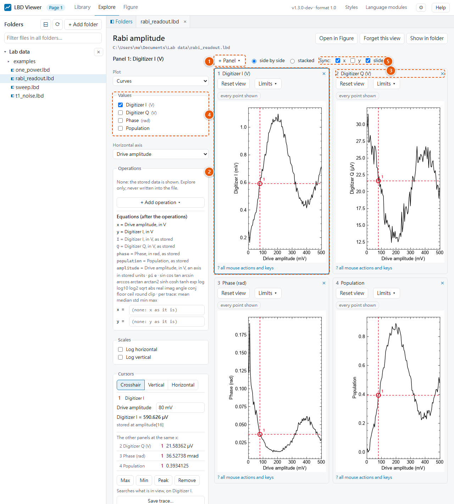
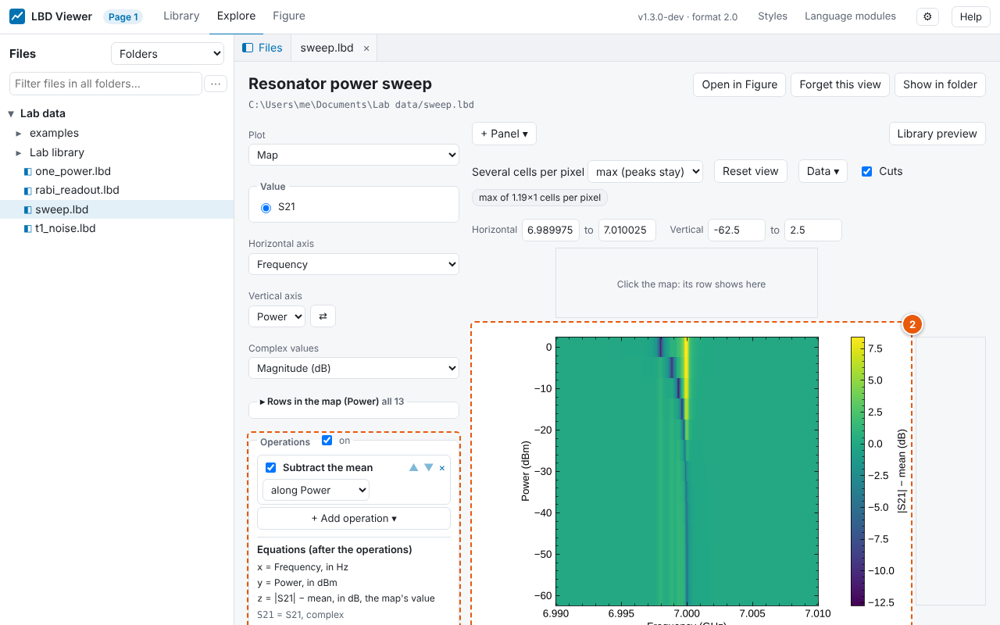
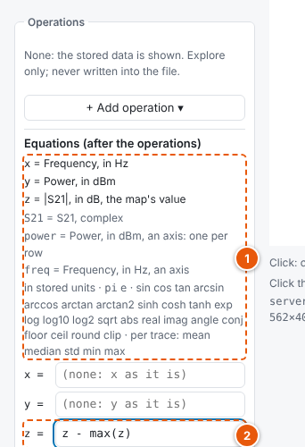

# Explore

**Explore** is where you look at data: zoom in, read exact values, step through traces, switch
between curves and maps. It is the viewer's default workspace: double-clicking a data file
opens it here. For a figure to export, use **Figure** (one click away, see below).

1. **Workspaces:** **Library** (find files), **Explore** (look at data) and **Figure** (make
   figures). Each has its own tabs; a file can be open in Explore and in Figure at once.
2. **Tabs** of the files open in Explore. A single click on a file shows it in a *preview* tab
   (in italics), which the next single click replaces; a double-click keeps it open. Right-click
   a tab to close it, open it in Figure or in a new browser tab.
3. **What to plot:** curves or a map, the values, the horizontal axis, one curve per … (or the
   map's vertical axis), complex values, and a slider for each other dimension.
4. **Which traces, scales and colours:** see [Choosing traces](#choosing-traces) and
   [Scales, colours and limits](#scales-colours-and-limits).
5. **How the data fits the screen:** for example "max of 6×8 cells per pixel" (see
   [Large data](#large-data)).
6. **The plot.** Zoom, pan and click on it, see [Moving around](#moving-around).
7. **The cursors' values**, as stored in the file, see [Reading values](#reading-values).

Below the side panel's colours is the **Cursors** section (see [Reading values](#reading-values)).
Click **?** under the plot (or press **?** on it) for every mouse action and key.

## Moving around

| Do | What happens |
|---|---|
| Turn the mouse wheel | Zooms in or out around the mouse. **Shift**: only horizontally; **Alt**: only vertically. |
| Drag with the left button | Zooms to the box you drew. A flat box zooms one axis only. |
| Drag with the right or middle button | Moves the view. |
| Double-click | Shows all the data again (also **Reset view**). |
| Click | Puts cursor 1 on the nearest stored point (curves) or on the cell (maps), see [Reading values](#reading-values). |
| Right-click | A menu: cursors, Max, Min, Peak, cuts, show everything. |
| Type in **Horizontal** / **Vertical** *from … to* | Shows exactly that range. Empty boxes mean "to the end of the data". |

Every picture is complete: its axes always match its data. While you zoom or pan, the data is
drawn at half resolution, which is faster; as soon as the mouse rests, the sharp picture follows.
Pictures are drawn by the same engine as the figures, so Explore and Figure look alike.

## Choosing traces

Under the controls, a list shows each position of the axis that makes the traces: **Curves
shown** (one curve per …) or **Rows in the map** (the map's vertical axis). While every trace
is shown, the list is folded under its title ("all 4001"); click the title to open it.

- Click a value: only that trace. **Shift**-click: every trace from the last one you clicked to
  this one. **Ctrl**-click (**⌘** on macOS) or the box: add or remove one.
- **All** and **None** at the top.

In a map, rows you leave out stay **empty, in their place**: the vertical axis always tells the
truth. (Packing the chosen rows together would move them.)

## Several values: panels

A measurement often records several values at each point: I, Q and a population, or an
amplitude and a phase. (Labber calls them *log channels*; in LBD they are **values**, and what
was swept, Labber's *step channels*, are the **axes**.) A file with several values opens in
Explore with **one panel per value**, side by side: up to four at first, up to six in all. A file
with one value shows one plot, as always. Single numbers never get a panel.

1. **+ Panel ▾** adds a panel for a value. **Side by side** / **stacked** arranges the panels;
   their grid follows from how many there are.
2. **The active panel** is outlined: click anywhere in a panel (or press **1** … **6**). The side
   panel shows its controls ("Panel 2: Q"): what you change there changes that panel only. Each
   panel has its own plot type, values, operations, equations, scales and colours.
3. **A panel's title bar**: drag it to move the panel; **×** removes it; right-click to
   **Duplicate** it (the same value twice, for example with and without an operation, or at two
   slider positions).
4. **Values** in the side panel: tick one to add it to the active panel, drag one onto a panel
   to add it there (or onto the bar above the panels for a new panel), right-click one for
   **Show in a new panel** or **Show only this value here**.
5. **Sync** above the panels:
    - **x** (on): zooming or panning in one panel does the same in every panel with the same
      horizontal axis; showing everything shows all their data. A panel on another axis says so
      in its title bar ("x not synced: Power (dBm), not Frequency (GHz)"); so does one whose x
      an equation or an FFT changed.
    - **y** (off): the same for the vertical axis, between panels with the same unit (maps: the
      same vertical axis).
    - **sliders** (on): moving a slider moves that axis' slider in every panel. Switch it off to
      show, say, ground and excited state side by side in two panels of the same value.

**One cursor for all:** while x is synchronized, a click in a panel puts the cursor at that x in
every panel with the same horizontal axis; each panel puts it on its own data (its own trace, or
in a map its own row). The panel you click in leads. The **Cursors** section lists the other
panels' values at the cursor ("The other panels at the same x"), with the difference between
two cursors. **Max**, **Min** and **Peak** search the active panel and move every cursor.

**Two units in one panel:** a value with another unit than the panel's first one goes on a
**right-hand axis**, labelled in its colour; its curves are dashed. The cursor reads each curve in
its own unit. Both axes zoom together. A panel shows two units at most: a value with a third
can't be ticked; show it in another panel. Operations and equations make one quantity of the
values (without a unit), so with them the panel has one axis.

## Reading values

1. **The row** through cursor 1, on the map's horizontal axis.
2. **The column** through cursor 1, on the map's vertical axis.
3. **Cursor 1** (red) on a cell, **cursor 2** (blue), and the range between them.

Under the plot are their values, as stored, and the differences and means between them. The
**Cursors** section of the side panel (below the colours) has the same and more: the cursor
type, typed positions, Max · Min · Peak, the cuts, and taking a cut out.

Cursors sit **on the stored data**: a click puts cursor 1 on the nearest point of the nearest
trace (curves) or on the cell (maps), and every number shown is the value stored in the file,
with its index ("stored at freq[4031], trace[12]"). Values are as plotted, for example |S21| in
dB for a complex value shown in dB.

| Do | What happens |
|---|---|
| Click | Cursor 1 there. |
| **Shift** + click | Cursor 2: a range, shaded, with the differences (Δ) and means between the two cursors. |
| Drag a cursor | Moves it. A cursor on a trace stays on that trace and follows it. |
| **Alt** + click or drag | A free position, not on the data; the read-out then gives the nearest stored value. |
| **Esc** | Removes the cursors. |

**Cursor types**, in the Cursors section:

- **Crosshair** (the default): a point of one trace, or a cell.
- **Vertical:** a line at one x; the section lists **every visible trace's value there**, the
  cursor's own trace first.
- **Horizontal:** a line at one height, for example to compare peaks with a level.

**The Cursors section** shows each cursor's numbers. Positions can be typed (with a prefix if you
like: `5.12 GHz`); the cursor then moves to the nearest stored point. **Max**, **Min** and
**Peak** move cursor 1 to the highest, the lowest, or the point farthest from the median (a dip
or a spike, whichever stands out more): between the two cursors when there are two, otherwise in
what is in view; on curves, on cursor 1's trace if it is on one. They search the stored data,
not the picture.

**Cuts** (maps): the row and the column through cursor 1 are drawn above and beside the map, on
exactly the map's axes, and follow the cursor while you drag it. Their value axis fits the part
in view; when a cut has more points than pixels, each pixel shows its lowest and highest value.
Hover a cut to read it. **Cuts** above the plot (or the key **C**) turns them off.

To switch the cursors off, click the chosen cursor type again (or press **K**): no type is
chosen, a click on the plot does nothing, and the cursors, cuts and values are hidden. Choose a
type (or press **K**) and the same cursors come back.

**Taking a cut out:**

- **Row as curve** / **Column as curve** shows that row or column as a curve in the same tab;
  **◂ Back to the map** returns.
- **Save row…**, **Save column…** (maps) and **Save trace…** (curves) write a new `.lbd` file in
  the same folder, with a suggested name you can change. It holds the stored data (complex
  values stay complex), its axis and units, and in its metadata where it came from: the source
  file, and the index and value of each fixed axis (`cut_from`, `cut_index`, `cut_at`; the
  source's own metadata under `source_meta`). The source file is not changed, and an existing
  file is never overwritten.

**Keys**, after clicking the plot:

| Key | Does |
|---|---|
| ← → | Moves the active cursor one stored point (**Shift**: 10). |
| ↑ ↓ | Curves: the next or previous trace; maps: one row. |
| Tab | Switches the active cursor (1 ↔ 2). |
| M, N, P | Max, Min, Peak. |
| [ ] | The first slider one step back or on. |
| + − | Zooms in or out around cursor 1. |
| Home or 0 | Shows everything. |
| C | Cuts on or off (maps). |
| K | Cursors on or off (off: a click does nothing; the same as clicking the chosen cursor type again). |
| Esc | Cancels a box being drawn; otherwise removes the cursors. |
| ? | The list of mouse actions and keys. |

## Operations

1. **The operations**, in order; here one: the mean along Power subtracted from each frequency
   column, which removes the background and leaves what changes with power.
2. **The plot** shows the result; its colour bar says what: |S21| − mean, in dB.

The **Operations** section (in the side panel, above Scales) works on the data as shown: add
operations with **+ Add operation**, in any order and as many as you like. Each runs on the
result of the ones above it. Explore only: they are remembered with the view on this computer,
never written into the file; **Figure** always shows the stored data.

**For complex values**, the first operations work on the complex numbers themselves, before
**Complex values** (magnitude, dB, phase …) turns them into numbers to plot. They stay at the
top of the list:

| Operation | What it does |
|---|---|
| **Electrical delay** τ | × e^(i·2π·f·τ) along the horizontal axis (a frequency): removes the phase slope of a cable. **Calculate** finds τ from the slope of the phase between the two cursors (otherwise in view), on cursor 1's trace (otherwise all shown traces). |
| **Rotation** φ | × e^(iφ). **Calculate** finds the angle that puts the spread of the I/Q points onto the real axis (between the cursors, or in view). |
| **Auto-rotate each trace** | turns each trace by its own such angle, so they line up. |
| **I/Q histogram** | counts the complex points of all shown traces in the I/Q plane (N × N bins): a map, with I and Q as its axes. It is the last operation; ones after it say so. |

**On the values as shown:**

| Operation | What it does | Unit |
|---|---|---|
| **Subtract the mean** | each trace minus its mean; *along* a map's other axis it removes a background that changes from row to row | as before |
| **Normalize** | (value − mean) / standard deviation | none (σ) |
| **Derivative** | d/dx, with the real steps (uneven ones too) | none: the label says what it is (dS21/dFrequency) |
| **Smooth** | a **running mean** over N points; a **Gaussian** of width σ points (it reaches ±3σ); or the **median** of N points (N odd: a one-point spike goes, a step stays sharp). Missing points are skipped and stay missing | as before |
| **Subtract the first trace** / **the previous trace** | across the traces (or a map's rows) | as before |
| **Average** / **Std of the traces** | one curve from the shown traces | as before |
| **FFT** | amplitude spectrum, positive frequencies (a sine of amplitude A peaks at A); needs evenly spaced points without gaps | as before; the new axis has none (its label says Frequency, Time, or 1/…) |
| **Histogram** | counts of the values, in N bins; the value becomes the horizontal axis | counts |

- Each operation runs **along** an axis: the horizontal axis (within each trace, or each row of
  a map), or **across the traces** (the curves of one curve per …, or along a map's vertical
  axis). Operations across traces use only the traces you chose.
- **▲ ▼** move an operation, **×** removes it, its box turns it off; **on** at the top turns
  them all off, to compare with the stored data.
- An operation that can't apply where it is (an FFT on uneven steps, "subtract the previous
  trace" after averaging) turns **red** with the reason; the plot then shows the result of the
  operations above it.
- Under the list: what the plot shows now, and in which unit. Units aren't worked out: an
  operation that keeps the unit keeps it, one that changes it shows none.
- **Nothing is hidden silently.** Points a log scale can't show (values ≤ 0) are counted in a
  note above the plot ("57 points ≤ 0 aren't shown on the log vertical axis"); a log scale with
  no value above 0 at all stays linear and says so; when an operation leaves nothing to show
  (Normalize of a constant trace), the plot says why instead of staying empty.
- **Cursors** read the values as shown and, while each shown point is still one stored point,
  also the stored value: `S21 − mean = 1.07 dB … (stored: S21 = 0.19 dB)`. After an average, an
  FFT or a histogram the points are new ones, so only the shown value is read, and a cut can't
  be saved (turn the operations off to save the stored data).

## Equations

1. **The legend:** what each name stands for, in stored units.
2. **An equation:** here each power's row of |S21| against its own maximum.

Below the operations are **equation** fields, as in Labber: `x =` and `y =` (for a map also
`z =`). They work on the data after the operations; an empty field leaves that part as it is.
Type a formula and press Enter (Esc puts the old one back).

Above the fields, a **legend** says what each name stands for, and in which unit. The numbers
are in **stored units**: Hz, not GHz, so `x * 1e-9` gives GHz.

- `x`, `y` — the horizontal axis and the value as shown (after the complex mode and the
  operations); for a map `x`, `y` are its axes and `z` its value.
- Every other value of the file with the same axes, as stored (complex values stay complex:
  `abs(S21_ref)`), and every axis, by name. An axis held by a slider is its one value. Names that
  aren't plain words go in backticks: `` `S21 (ref)` ``.
- `pi`, `e`; `+ − * / **` and parentheses; the functions `sin cos tan arcsin arccos arctan
  arctan2 sinh cosh tanh exp log log10 log2 sqrt abs real imag angle conj floor ceil round clip`,
  and per trace `mean median std min max` (so `y - mean(y)` subtracts each trace's mean).

Examples: `y - 0.5 * power`, `abs(S21) / abs(S21_ref)`, `x * 1e-9`, `10 * log10(y)`.

- The result has **no unit**; the axis is labelled with the equation.
- Only formulas are read: LBD checks every part itself and never runs what is typed as a
  program.
- A field that can't be used turns red and says why (a typing mistake and where it is, a name
  that doesn't exist with the names that do, a complex result: take `abs()`, `real()` …); the
  plot then leaves that field out.
- Points without a value (`sqrt` of a negative number, `log` of 0, 0/0) become gaps, and a note
  under the field counts them.
- `x =` may give each trace its own x, or an order that isn't sorted (curves are then drawn
  point after point). A map's axes must stay sorted.
- Like the operations, equations are remembered with the view on this computer, never written
  into the file, and turned off with the operations' **on** switch.

## Scales, colours and limits

- **Scales:** log horizontal, log vertical, and for maps a log colour scale. Values of 0 or
  below can't be shown on a log scale and are left out.
- **Colour** (maps): a colour map (*viridis*, *plasma*, *magma* and *cividis* are even to the
  eye; *gray*; *RdBu* for values around zero; *twilight* for phases, which wrap around),
  **Invert**, and the **Colour range** (empty: from the data).
- **Contrast** (maps): a histogram of the map's values (all its cells, not only the view) with
  the colour range as two lines. Drag a line to move that end, or drag between them to move the
  range. **Auto** leaves out the outliers (0.5 % of the cells at each end), **Full** spans every
  value, **Style** goes back to the style's own range. The colour range stays the same while
  you zoom.
- **Complex values:** magnitude, dB, phase in radians or degrees, the phase **unwrapped** (its
  2π jumps along the horizontal axis removed), real or imaginary part.

## A value as the horizontal axis

The horizontal axis can also be another value of the file with the same axes, for example a
frequency that differs from trace to trace (a VNA whose span changes with power). Each trace is
then drawn at its own x. A value against a value that isn't sorted (say a phase against a
magnitude) is drawn point after point as stored, and the note says so; with more than 200 000
points it is thinned for drawing, keeping the lowest and highest point of each stretch.

## Large data

A screen has far fewer pixels than a large file has numbers: a map of 4001 × 4001 cells shown
in 700 × 500 pixels puts about 50 cells into each pixel. The viewer chooses on purpose what a
pixel shows, and says so in the note above the plot:

- **Maps:** **Several cells per pixel** sets whether a pixel shows the **max** of its cells
  (peaks and single hot cells stay visible), the **min** (dips stay visible) or the **mean**
  (the overall look; a single odd cell fades).
- **Curves:** each pixel column keeps the lowest and highest point in it, so a spike of one point
  still shows.
- **Many curves** (more than 30 on screen) are drawn together as one picture, which is much faster;
  their lines are then not smoothed (antialiased), so they look a little sharper-edged. Choose a
  few traces to see them drawn as in a figure.
- Zoomed in far enough, every cell or point is drawn as stored ("every cell shown").

Cursor values never come from the picture: they are read from the file's data.

## What is remembered, and where

The viewer remembers how you explored each file: its panels and what each plots, the chosen
traces, the operations and equations, colours, scales, limits, the zoom, the cursors and what is
synchronized. Opening the file again shows the same.

- This is kept **on this computer**, in the viewer's own database (in its settings folder, see
  [Command line and settings](command-line.md)). **Nothing is written into the data file.** The
  file holds the data, its description and the figure's saved view (see
  [Saving views](saving-and-exporting.md)).
- Without a remembered view, Explore starts from what the file's saved figure view plots.
- **Forget this view** (at the top) starts afresh. If a file changed so that a panel no longer
  fits (a value or axis it used is gone), that panel is left out and a note names it; if none
  fits, Explore starts afresh.
- Views remembered by an earlier version (one plot, before panels) open as one panel.
- Renaming a file in the viewer keeps its remembered view.

## Files that change

When the program writing a file adds data (a measurement or a simulation that runs), Explore
shows the new data within about two seconds and **keeps your zoom, choices and cursors** (their
values are read again). If all the data
was shown, the view grows with it. If the file was rewritten with other contents (other axes or
values), Explore starts afresh and a note says why. A file that is still being written shows
"Updating…" until it can be read.

## Explore and Figure

- **Open in Figure** (at the top of an Explore tab) opens the same file in Figure, with the
  figure's own settings and style ([Plotting](plotting.md)). Panels and the right-hand axis are
  Explore's: a figure shows one plot.
- In Figure, **Open in Explore** goes the other way.
- In the folder panel, right-click a data file: **Open in Explore** or **Open in Figure**.
- Data files double-clicked in File Explorer or Finder open in Explore, or in Figure: choose in
  **⚙** (see [Settings](index.md#settings)).
