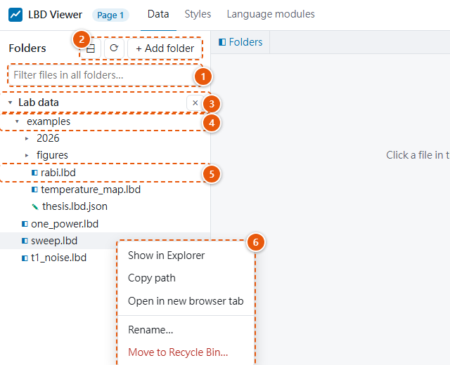
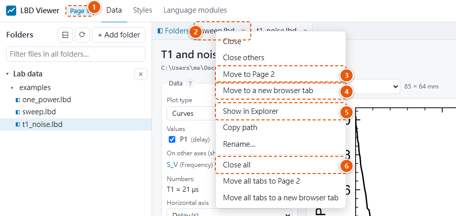

# Folders and files

## Folders

The folder panel lists folders you choose, and inside them every subfolder and these files.

{ width="560" }

1. **Filter files in all folders…:** type part of a file name to find it in every listed folder.
2. **⊟** closes all folders, **⟳** rereads them, **+ Add folder** adds one.
3. **A folder you added.** Its **×** removes it from the list (no files are deleted).
4. **A subfolder:** click to open or close it.
5. **A file.** The icon shows its kind (below). Click to look at it, double-click to plot it.
6. **The right-click menu** of a file: show it in Explorer, copy its path, open it in a new
   browser tab, rename it, move it to the Recycle Bin.

| Icon | Files | Clicking opens |
|---|---|---|
| ◧ | `.lbd` data files | the file's details and plot |
| ✎ | `.lbd.json` style files | a preview of the style; see [Style files](images-and-style-files.md#style-files) |
| ▣ | images: `.png .jpg .jpeg .gif .bmp .tif .tiff .webp .svg` | the image and its metadata, view only; see [Images](images-and-style-files.md#images) |

Other files are not shown.

| To | Do this |
|---|---|
| Add a folder | **+ Add folder**, then **Browse…** to pick one, or paste a path (for example copied from the Explorer address bar) and press **Add**. Quotes around a pasted path are removed. |
| Remove a folder | The **×** next to its name. It is only removed from the list; no files are deleted. |
| Open or close a folder | Click it, or select it and press Enter. Open folders are remembered in this browser. |
| Close all folders | The **⊟** (collapse all) button. |
| Make the panel wider | Drag its right edge. Double-click the edge to fit the longest name shown. The width is remembered in this browser. With the keyboard: focus the edge (Tab), then ← / →; Home resets it. |
| Find a file | Type in **Filter files in all folders…**. It searches every subfolder of every listed folder for file paths containing the text, ignoring case. At most 500 matches are shown per folder. |
| See new files | Nothing to do: new, rewritten and deleted files show up within a few seconds (see [Files that change](#files-that-change)). **⟳** rereads the folders at once. |
| Open a file in a new browser tab | Ctrl+click it (⌘+click on macOS), middle-click it, or right-click → **Open in new browser tab**. |
| Hide the panel | **◧ Folders** at the left of the tab row, for more room for plots; click it again to show the panel. Each browser tab remembers its own choice. |

Hidden and system folders are skipped:
- names starting with `.`,
- `__pycache__`, `node_modules`, `venv`,
- Synology's `@eaDir`, `#recycle` and `#snapshot`,
- Windows' `$RECYCLE.BIN` and `System Volume Information`.

### Right-click menu

Right-click an item in the panel (or select it and press the Menu key or Shift+F10):

| Item | Menu |
|---|---|
| A listed folder | **Show in Explorer**, **Copy path**, **Remove from list** |
| A subfolder | **Show in Explorer**, **Copy path** |
| A data, style or image file | **Show in Explorer**, **Copy path**, **Open in new browser tab**, **Rename…**, **Move to Recycle Bin…** |

On macOS the menu says Finder and Trash, on Linux file manager and Trash.

- **Show in Explorer** opens the folder with the file selected.
- **Rename…** asks for the new name. The extension must stay the same (`.lbd`, `.lbd.json`, or
  the image's), so the file stays in the panel; a name that already exists is refused. An open
  tab of the file follows the new name, in whichever browser tab it is open, and keeps its
  unsaved settings.
- **Move to Recycle Bin…** asks first, then moves the file to the Recycle Bin (Trash), where
  you can restore it. If the drive has no Recycle Bin (some network drives), the file is not
  deleted and you get a message. An open tab of the file is closed, with a note.

Folders can't be renamed or deleted from the viewer.

**Browse…** opens your system's folder dialog. If your system has none (some minimal Linux
installs), paste the path instead.

The viewer can only read files inside the listed folders, and files you open directly by
double-clicking or from the command line.

## Tabs

| Action on a file | Result |
|---|---|
| **Single-click** (or Space) | Opens the file in a *preview tab*, whose name is in italics. For data files it shows the details. The next single-click replaces the preview tab, so browsing doesn't pile up tabs. |
| **Double-click** (or Enter), or the **Plot** button | Keeps the tab; data files are plotted. |

Click a tab to switch to it, double-click a preview tab to keep it, and close a tab with its
**×**. Each tab keeps its own plot settings while it is open. Keeping several files in tabs is
a quick way to compare them.

To act on several tabs, select them: Ctrl+click (⌘+click on macOS) adds or removes a tab,
Shift+click selects a range. Right-click a tab (or the file's name above its plot) for:
- the tab: **Close**, **Close others**, **Move to Page N** with the files that page already has,
  **Move to a new browser tab** (see [Several browser tabs](#several-browser-tabs));
- its file: **Show in Explorer**, **Copy path**, **Rename…**;
- all tabs: **Close all**, **Move all tabs to Page N**, **Move all tabs to a new browser tab**.

The tab part acts on the selected tabs if you right-click one of them, otherwise on that tab
alone.

The menu for all tabs is also on the empty part of the tab row (right-click) and on the **⋯**
button at its right end, which stays in place however many tabs are open.

Ctrl+click means *select* on a tab, but *open in a new browser tab* on a file in the Folders
panel.

## Several browser tabs

You can open the viewer in several browser tabs or windows, for example to compare two files
side by side: put two browser windows next to each other, and hide the Folders panel in each.

Each browser tab showing the viewer is a numbered **page**: its title and the badge at the top
say **Page 1**, **Page 2**, …. A new page takes the lowest free number, so after you close
Page 2, the next page you open is Page 2 again.

**Files you open from Explorer or Finder** (a double-click, or `lbd-view file.lbd`) go to the
page you used last, as kept tabs. That page comes to the front, or, if the browser doesn't
allow it, its tab title flashes ("● 1 file arrived"). With no page open, a new browser tab
opens. To get a new browser tab every time instead, choose it under **⚙** at the top right:
*Files opened from Explorer / Finder: in a new browser tab*.

**A file is open in one page at a time.** So two pages can never hold different unsaved
settings for the same file. Opening a file that another page has asks **Show it in Page N**,
and a file from Explorer that is already open is shown in its page.

1. **This page's number**, also in the browser tab's title.
2. **The tab** that was right-clicked (or the selected tabs).
3. **Move to Page 2:** the other open pages are listed with the files they already have.
4. **Move to a new browser tab** opens a new page with the tab in it.
5. **The tab's file:** show it in Explorer, copy its path, rename it.
6. **All tabs:** close them, or move them all to another page or a new browser tab. The same
   menu opens from the empty part of the tab row and from the **⋯** button at its end.

**Moving tabs.** Right-click a tab → **Move to Page N** or **Move to a new browser tab**. The
tabs move with their unsaved settings. While they are moving, they show ⇢ and can't be closed,
saved, renamed or moved again. The files leave this page only once the other page has them: if
that page is closed, or a new browser tab is blocked or closed before it opens them, the move
is cancelled, the tabs stay here, and a message says why.

The **Move to Page N** entries always list the pages that are open now. A page you close leaves
the other pages' menus within a few seconds, even if the browser didn't say it was closing (a
crash, a killed browser). A menu that is open at that moment updates itself: the entry turns
grey and says *Page 2 was closed*.

If your browser blocks the new tab, allow pop-ups for the viewer's address
(`http://127.0.0.1:…`).

Changes reach every page: a renamed or deleted file updates the page that has it open, and
added or removed folders and changed style presets show in every page.

A page that was asleep for a while (a closed laptop) registers again when it wakes up. Its
tabs stay, except files another page opened meanwhile: they show 🔒 *now open in Page N*.

## Files that change

When a program writes a file again while the viewer shows it, for example a simulation you run
over and over while fixing it, the viewer shows the new version by itself, within about two
seconds. You don't need to close and open the file.

- **An open tab** reads the file again and redraws its plot. Above the plot it says *Updated
  14:32:05*.
- **Unsaved plot settings are dropped**, with a message, because they were made for the data
  before. To keep a view across runs, save it into the file (**Save this view to the file**) or
  have your program write it, then every new version opens like that.
- **The Folders panel** shows new files, and removes deleted ones, in the folders that are open.
- **A file that is gone** (deleted, or being written again) stays on screen as it was, with a
  note, and updates when it is back.
- **A file that can't be read yet** (still being written) keeps showing the previous version
  while the viewer tries again. If it still can't be read after about 10 seconds, the note
  says why; it updates when the file is written again.
- **A tab moved to another page** while its file changed drops its unsaved settings the same way.

The viewer only looks at each file's size and time to notice a change; it never keeps a file
open. While a browser tab is in the background, it doesn't check; it catches up as soon as you
come back to it. Images and style files update the same way.

The language modules write a file under a temporary name and then put it in place, so the
viewer never sees half a file from them. On Windows, if the viewer happens to be reading the
file at that moment, saving waits for it (up to 3 seconds).

## File details

Under **File contents** you see:
- the description, creation time, writing program, file size and format version;
- a **Values** table: name, label, unit, axes, shape and type;
- an **Axes** table: name, label, unit, number of points, first and last value;
- **Metadata** as a tree; large arrays are summarized.

**Show in folder** opens the file's folder in File Explorer or your file manager, with the file
selected.
