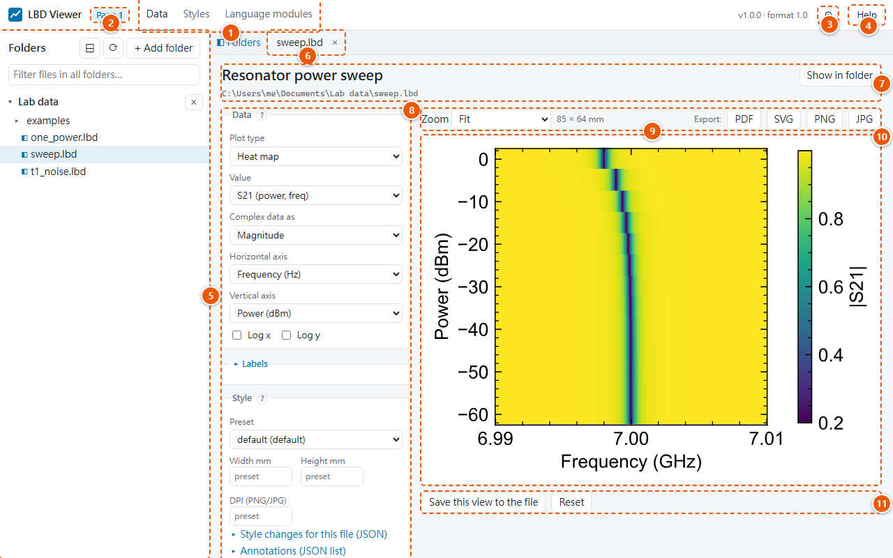
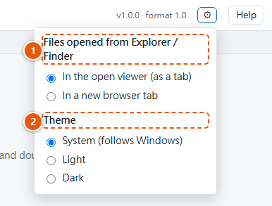

# LBD Viewer

LBD Viewer lists the `.lbd` files in your folders and plots them. It also shows your figures
and style files. It runs on your own computer and shows its window in your web browser.
Nothing is uploaded anywhere.

## The window at a glance

1. **Pages of the viewer:** **Data** (your files and plots), **Styles** (how figures look) and
   **Language modules** (installing the Python, MATLAB and Julia modules). See
   [The viewer's pages](#the-viewers-pages) below.
2. **Page number:** this browser tab's number. You can open the viewer in several browser tabs.
   Each is a numbered *page*, and you can move open files between them. See
   [Several browser tabs](folders-and-files.md#several-browser-tabs).
3. **⚙ Settings:** where files opened from Explorer go, and the light or dark theme. See
   [Settings](#settings).
4. **Help** opens this documentation. It is part of the viewer, so it works without internet.
5. **Folder panel:** the folders you added, with their data files, style files and images.
   Click a file to look at it, double-click to plot it. See [Folders and files](folders-and-files.md).
6. **Tabs:** the files open in this page. **◧ Folders** at the left hides the folder panel for
   more room. Right-click a tab to close it or move it to another page. See
   [Tabs](folders-and-files.md#tabs).
7. **File header:** the file's title and path, and **Show in folder**.
8. **Plot controls:** what to plot and how, and the style. See [Plotting](plotting.md).
9. **Figure toolbar:** zoom, the figure's printed size, and **Export** as PDF, SVG, PNG or JPG.
   See [Exporting](saving-and-exporting.md#exporting).
10. **The figure:** exactly as it will be exported, redrawn after every change.
11. **Save this view to the file** stores your plot settings inside the `.lbd` file, and
    **Reset** drops unsaved changes. See [Saving a view](saving-and-exporting.md#saving-a-view-into-the-file).

Below the figure, **File contents** shows the file's description, values, axes and metadata.

## Starting the viewer

- **Double-click an `.lbd` file** in File Explorer (Windows), Finder (macOS) or your file
  manager (Linux). The viewer opens it as a tab in the viewer page you used last, or in a new
  browser tab if none is open.
- **Start menu / applications menu / desktop shortcut → LBD Viewer** opens the viewer without
  a file, in a new browser tab, also when the viewer already runs. (The viewer can't bring an
  open browser tab to the front: browsers don't allow it.)
- **Command line:** `lbd-view`, `lbd-view file.lbd` or `lbd-view some/folder`; see
  [Command line](command-line.md#command-line).

Only one copy of the viewer runs at a time. Opening more files adds them to the same viewer.

## Settings

{ width="380" }

**⚙** at the top right holds two settings. They are saved, and apply to every viewer tab and to
the next start:

1. **Files opened from Explorer / Finder:** *in the open viewer (as a tab)*, which is the
   default, or *in a new browser tab* every time.
2. **Theme:**
    - **System** follows the light or dark mode of Windows, macOS or Linux, also when it changes
      while the viewer is open.
    - **Light** and **Dark** stay as chosen.

    Figures always stay on white, because they are print figures. The Help pages have their own
    light/dark switch.

## The viewer's pages

| Page | What it does |
|---|---|
| **Data** | The folder panel and the open files: [Folders and files](folders-and-files.md), [Plotting](plotting.md), [Saving views and exporting](saving-and-exporting.md). |
| **Styles** | Create and edit style presets, and choose the default one: [Styles page](styles-page.md). |
| **Language modules** | How to install the Python, MATLAB and Julia modules on this computer: [Language modules page](language-modules.md). |
| **Help** | Opens this documentation in a new tab. |

Small **?** buttons next to the plot controls, on the Styles page and on the Language modules
page open the matching page of this documentation.

## How it runs

- The viewer is a small web server on your computer. It only accepts connections from this
  computer (`127.0.0.1`).
- Each start creates a random **session code**. It is part of the address the viewer opens and
  is required for every request. This stops other web pages in your browser from reading your
  files through the viewer. As a result, a bookmarked address only works while that viewer is
  running.
- **Single instance:** a second start (for example double-clicking another file) hands the
  file to the running viewer, instead of starting a second server.
- **Automatic shutdown:** open tabs tell the viewer every 10 seconds that they are still there.
  About 90 seconds after the last tab closes, the viewer stops by itself. If no tab connects at
  all after a start, it waits at least 60 seconds first.
