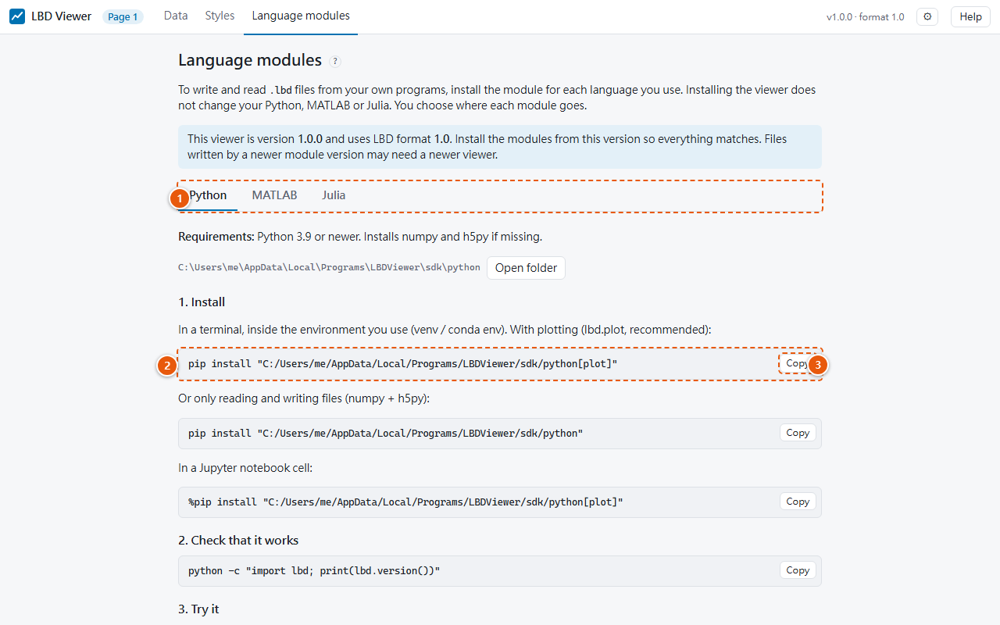

# Language modules page

Shows how to install the language modules, for writing and reading `.lbd` files in your own
programs, one for each [supported language](../getting-started/install.md#language-modules).

1. **One tab per language.**
2. **The install command**, with the real path on this computer filled in.
3. **Copy** puts it on the clipboard; paste it where the page says (a terminal, or the
   language's own console).

Each tab lists:

- the requirements;
- the install command, with the real path on this computer filled in, and a **Copy** button;
- a command to check the install, an example program, and the upgrade and uninstall commands;
- an **Open folder** button for the folder containing the module files.

The viewer never installs anything into your languages' environments; you choose where.
Install the modules of the same version as the viewer, which is shown at the top of the page.
See also [Install](../getting-started/install.md).
