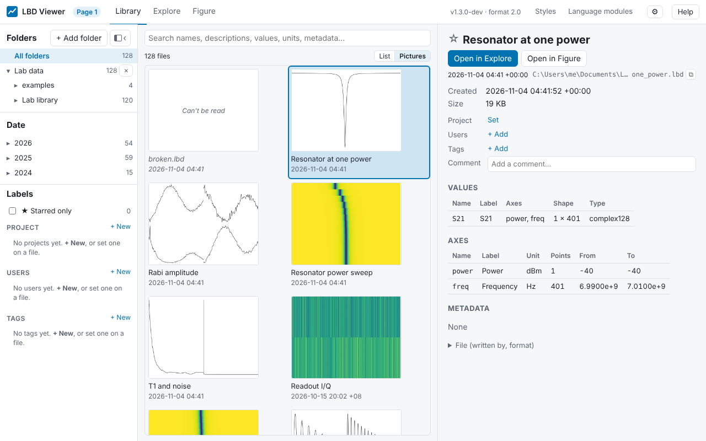

# Library

**Library** is where you find measurements, like Labber's Log Browser: every data file under
your folders in one list, which you narrow down by folder, date and search, and the file you
select described on the right.

1. **Folders:** the folders you opened in the viewer, with the number of data files below each.
   **All folders** lists everything in all of them as one list; a folder lists everything below
   it, at any depth. **+ Add folder** and **×** add and remove folders (no file is touched); this
   is the one place to do it.
2. **Dates:** year → month → day, with the number of files on each. Click one to see only those
   files; click it again to see all dates.
3. **Search:** type words to find files that contain all of them, in their name, description,
   value and axis names and units, or metadata (keys and values). The line below says what is
   shown, e.g. "37 of 412 files · Date: 2026 › Mar · Search: "resonator"", with an **×** for each
   filter and **Clear all**.
4. **The list:** one row per data file, newest first. Click a column title to sort by it; click
   again to reverse. Right-click the titles to choose the columns.

The folders, dates and labels on the left are the **Filters**: the **Filters** button left of
the search box hides or shows them (the number on it counts the filters in use). The filters
belong to the browser tab: they stay while you go to Explore or Figure and back, and the
[Files sidebar](folders-and-files.md#the-files-sidebar) there lists the same files.
5. **The selected file:** its title, its path on one line (⧉ copies it; point at it for the
   whole path) and date, **Open in Explore** and **Open in Figure**, a [preview](#previews) of
   its data, then its axes (points and range), values, description and metadata (with a filter
   box for long lists).

## Columns

| Column | Shows |
|---|---|
| **Name** (shown) | the file's title; the file name when it has none |
| **Date** (shown) | when the data was created, as written in the file; its time zone is shown short (`+08`) when it isn't your computer's |
| **Sweep size** (shown) | the swept axes' points, e.g. `401×31`; empty for a file of single numbers |
| **Values** | the names of the values in the file |
| **Folder** | where the file is, below its open folder |
| **File size**, **File name**, **Modified** | from the disk |

The columns you choose are remembered. When the list is too narrow for them all, the ones least
needed to tell files apart are left out (Modified first, then File name, Folder, …; Name always
stays), and a **+N** at the end of the titles says how many: point at it for which, click it to
choose. A wider window shows them again.

## Dates

The date of a file is its `created` time: when its data was created, written into the file by
the program that made it, in the time zone it was made in. A measurement at 23:30 in Taipei is
on that day wherever you browse it from, and copying, syncing or renaming the file doesn't change
it. A file whose date can't be read is dated by its file's modification time, shown greyed
(point at it to see why).

## Keys and mouse

| Do | What happens |
|---|---|
| Click a row | shows the file on the right |
| ↑ ↓, Page Up, Page Down, Home, End | move through the list (the right side follows) |
| ← → | in the picture view: the file before or after |
| Enter, or double-click | opens the file in [Explore](explore.md) |
| Shift+Enter | opens it in Figure ([Plotting](plotting.md)) |
| Right-click a row | open in Explore or Figure, show in folder, copy the path, open in a new browser tab, rename, move to the Recycle Bin / Trash |

## Files that change

The list keeps itself up to date: a new data file appears, a removed one disappears and a changed
one is read again within a few seconds, while your selection stays. A file that can't be read
(damaged, not an LBD file, or from a newer LBD) stays in the list, greyed and marked ⚠; select it
to see why in plain words (the technical message is under **Details**).

## Narrow windows

In a window narrower than about 1280 pixels (half a screen, a laptop), the **Filters** slide over
the list when you click the button, and close when you choose a folder or a date, press Esc or
click beside them. Below about 900 pixels the Library shows one thing at a time: the list, or
the file you clicked, with **← Back to the list** (or Esc).

## Files being written

A measurement written with the Writer (see
[Writing while measuring](../getting-started/writing-while-measuring.md)) is called
`name.lbd.writing` until it is finished. The Library lists it with its state:

- **measuring…**: its measurement is writing it right now, on this computer. Explore and the
  selected file show its progress as it grows. It gets no preview until it is finished, and LBD
  never writes into it (only the measuring program does).
- **measuring elsewhere…**: it is measured on another computer and synced here (its heartbeat,
  `name.lbd.live`, says so and keeps changing): *Measuring on LAB-PC*.
- **no sign lately**: measured on another computer, but no sign of it came for about ten minutes
  (longer for a measurement with slow steps): it probably stopped, or the sync is paused; this
  computer can't tell which. **Recover a copy…** makes `name (recovered).lbd` and leaves the
  file being written as it is.
- **stopped before finishing**: its measurement ended without finishing it (a crash, an error,
  a script that ended without closing it). Select it and click **Recover**: it becomes
  `name.lbd` (or `name (2).lbd`) with everything it holds.

See [Writing while measuring](../getting-started/writing-while-measuring.md) and
[Several computers](../getting-started/several-computers.md).

## Previews

The selected file shows a picture of its data on the right, as Explore first shows it: one panel
per value (up to four), curves for a value over one swept axis, a heat map over two. Step through
the list with ↑ ↓ and the pictures follow at once: the files near the selection are drawn ahead.

- **Pictures** (above the list, next to **List**) shows the files as a grid of pictures, with
  their name, date and state (*measuring…*, *stopped*); click, select several, right-click and
  the keys work as in the list. The selected file on the right then leaves out its preview (the
  grid shows it). Point at "No preview" on a card to see why.

    

- **Choose a file's picture:** open it in Explore, show what you want (panels, zoom, operations),
  then **Library preview** (above the panels, on the right). The Library then shows that picture, "Chosen in
  Explore on …", and keeps it however you change Explore afterwards. Only the picture is kept,
  so it shows the data as it was then: if the file changes later, it says "before the file last
  changed"; choose again to update it. **Reset preview** goes back to the automatic one.
  Identical copies of a measurement share a chosen picture.
- **Automatic pictures** are drawn again when their file changes (data added). They ignore the
  file's saved figure view and style: a preview is about the data, the same for every file.
- A file without a picture says why, e.g. "only single numbers".

**⚙ → Library → Previews** sets which pictures are drawn without being asked:

| Choice | What happens |
|---|---|
| **Every file, drawn in the background** (default) | every file's picture is drawn once, after the list is read (the line above the list counts them); then every preview shows at once |
| **The selected file and the rows near it** | only what you look at, and the files near it |
| **Only when I click Show preview** | no file is read for a picture by itself; the right side has **Show preview** |

"Every file" reads every file in full, so it needs **Read each data file's details** on (see
below); while that is off, the files near the selection are drawn instead. Drawing happens in the
background at low priority, so Explore and the rest of the computer stay quick. The pictures are
kept on this computer (about 20–40 kB each); **⚙ → Library → Picture cache → Empty** removes
them (they are drawn again when needed; pictures you chose in Explore are kept).

## Reading each file's details (cloud storage)

To list dates, sweep sizes and values, and to search inside files, the viewer opens each data
file once and reads its header (not its data); after that only files that changed are read again.

In a folder kept in cloud storage with files only in the cloud (Synology Drive on-demand sync,
OneDrive Files On-Demand, Dropbox online-only …), opening a file downloads all of it. For such
folders, switch off **⚙ → Library → Read each data file's details**. The list then shows only
what the disk tells (file name, size, file dates), search looks at names only, and a file's
details are read when you select it. The setting is on when the viewer is installed; a notice
above the list says so the first time.

## Labels: star, project, users, tags, comment

Give files labels to find them again, as in Labber's Log Browser:

| Label | Per file | Example |
|---|---|---|
| **★ Star** | yes or no | the good measurements |
| **Project** | one | `Qubit A/Device 3` |
| **Users** | any number | `Lab A/Qubit team/Patrick` (group / sub-group / name) |
| **Tags** | any number | `resonator`, `flux/bias` |
| **Comment** | text | "punch-out at −20 dBm; redo with more averages" |

Projects, users and tags can be **nested** with `/`: choosing `Qubit A` in the filter also shows
everything under `Qubit A/…`.

- **Set them** in the right column (the **Labels** section): ★, Project, Users and Tags (**+**
  opens a list of the labels already used, with how many files have each; type to find one or
  to make a new one; for users, this computer's login name comes first), and Comment (saved when
  you leave the box).
- **Several files at once:** select them (**Ctrl**+click, **Shift**+click, **Ctrl+A**), then
  label them in the right column ("5 of 12" shows a label only some of them have) or with the
  right-click menu. **Space** stars or unstars the selected files.
- **Filter** with the boxes on the left (Project, Users, Tags, ★ Starred only): several choices
  in one box show files with any of them; choices in different boxes must all match. Search also
  finds labels and comments.
- Labels are kept in a small file in each folder, `.lbd-library.json`, next to the data files:
  **data files are never changed for a label**, and labels travel with the folder (copied,
  synced, backed up). Its format is described in
  [The Library's label file](../developers/library-sidecar.md).
- **Two computers** (a folder synced with Synology Drive, OneDrive, Dropbox …) can label the same
  folder: changes are merged, label by label, and nothing is lost. If both changed it while
  apart, the sync tool keeps a "conflict" copy of the label file; LBD merges it and moves it to
  the Recycle Bin, and tells you.
- **The file's description** (written by the program that measured) is shown above, unchanged:
  the comment is for notes added later.

## Copies and the same measurement

When a file is first saved, LBD gives the measurement a **hidden identity** inside the file
(format 1.1; every language module does it, with no setup). That is how the Library recognises
the same measurement in two places — a backup, a shared folder, a file copied in Explorer — even
under another name.

- **Identical copies** show "2 copies" and, in the right column, "Also at …" with **Show it**.
  They share their labels: labelling one labels all of them.
- **Files renamed or moved outside LBD** keep their labels: the Library finds them again by
  their identity (older files without one: by their place on the disk, then by their date).
  Labels whose file can't be found are listed under **Missing** on the left: **Point to a file…**
  or **Discard**.
- **Copies that differ** (⚠): two files with the same identity but different contents — usually
  one was changed after it was copied (for example its description was edited in Python), or a
  program copied the identity by hand. The right column shows both files side by side, what
  differs, and three choices:
    - **Make this a new measurement** — this file gets its own identity (written into this file
      only, after you confirm; the other file is not touched). Its labels stay, and stop
      following the other file's.
    - **They are the same measurement** — nothing is written into either file; their labels
      follow each other again. If one of them changes again, you are asked again.
    - **Move this one to the Recycle Bin** — you can get it back from there.
  Until you choose, nothing about the two files is changed, merged or shared.
- **To make a separate measurement on purpose:** right-click → **Duplicate as new measurement**
  (a copy next to it, `name (copy).lbd`, with its own identity; the original is not touched); or
  from a program, save under another name (a new identity, with the original's as its parent),
  or call `new_id()` (`newId()` in MATLAB, `new_id!` in Julia).
- **Files written before LBD 1.3** have no identity yet; they get one the next time a language
  module saves them, or right-click → **Give these files an id** (writes it into them, after you
  confirm).

## What is kept, and where

The list comes from an index on this computer (`library.sqlite`, in LBD's local data folder, see
[Command line and settings](command-line.md)). It holds only what is in the files, so deleting it
is safe: the files are read again. **The Library never writes into data files.** The automatic
previews are a cache next to it (`previews.sqlite`), safe to delete in the same way; pictures
chosen in Explore are kept with the remembered Explore views (`catalog.sqlite`).

Explore and Figure have the Files sidebar on the left, listing the same files as the Library
(with this browser tab's filters), so you can open the next file without leaving them: see
[The Files sidebar](folders-and-files.md#the-files-sidebar).
