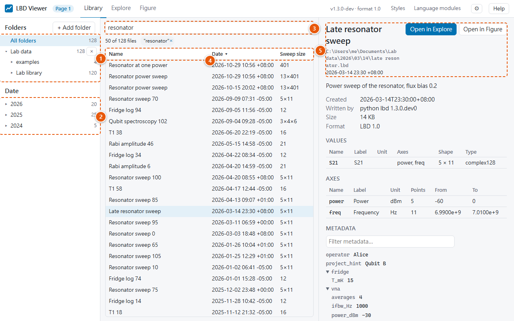

# Library

**Library** is where you find measurements, like Labber's Log Browser: every data file under
your folders in one list, which you narrow down by folder, date and search, and the file you
select described on the right.

1. **Folders:** the folders you opened in the viewer, with the number of data files below each.
   **All folders** lists everything in all of them as one list; a folder lists everything below
   it, at any depth. **+ Add folder** and **×** add and remove folders (no file is touched).
2. **Dates:** year → month → day, with the number of files on each. Click one to see only those
   files; click it again to see all dates.
3. **Search:** type words to find files that contain all of them, in their name, description,
   value and axis names and units, or metadata (keys and values). The line below says what is
   shown, e.g. "37 of 412 files · 2026 › 03 · "resonator"", with an **×** for each filter.
4. **The list:** one row per data file, newest first. Click a column title to sort by it; click
   again to reverse. Right-click the titles to choose the columns.
5. **The selected file:** title, date, folder, **Open in Explore** and **Open in Figure**, then its
   axes (points and range), values, description and metadata (with a filter box for long lists).

## Columns

| Column | Shows |
|---|---|
| **Name** (shown) | the file's title; the file name when it has none |
| **Date** (shown) | when the data was created, as written in the file, with its time zone |
| **Sweep size** (shown) | the swept axes' points, e.g. `401×31`; empty for a file of single numbers |
| **Values** | the names of the values in the file |
| **Folder** | where the file is, below its open folder |
| **File size**, **File name**, **Modified** | from the disk |

The columns you choose are remembered.

## Dates

The date of a file is its `created` time: when its data was created, written into the file by
the program that made it, in the time zone it was made in. A measurement at 23:30 in Taipei is
on that day wherever you browse it from, and copying, syncing or renaming the file doesn't change
it. A file whose date can't be read is dated by its file's modification time, shown with
"(file date)".

## Keys and mouse

| Do | What happens |
|---|---|
| Click a row | shows the file on the right |
| ↑ ↓, Page Up, Page Down, Home, End | move through the list (the right side follows) |
| Enter, or double-click | opens the file in [Explore](explore.md) |
| Shift+Enter | opens it in Figure ([Plotting](plotting.md)) |
| Right-click a row | open in Explore or Figure, show in folder, copy the path, open in a new browser tab, rename, move to the Recycle Bin / Trash |

## Files that change

The list keeps itself up to date: a new data file appears, a removed one disappears and a changed
one is read again within a few seconds, while your selection stays. A file that can't be read
(damaged, not an LBD file, or from a newer LBD) stays in the list, greyed; point at it, or select
it, to see why.

## Reading each file's details (cloud storage)

To list dates, sweep sizes and values, and to search inside files, the viewer opens each data
file once and reads its header (not its data); after that only files that changed are read again.

In a folder kept in cloud storage with files only in the cloud (Synology Drive on-demand sync,
OneDrive Files On-Demand, Dropbox online-only …), opening a file downloads all of it. For such
folders, switch off **⚙ → Library → Read each data file's details**. The list then shows only
what the disk tells (file name, size, file dates), search looks at names only, and a file's
details are read when you select it. The setting is on when the viewer is installed; a notice
above the list says so the first time.

## What is kept, and where

The list comes from an index on this computer (`library.sqlite`, in LBD's local data folder, see
[Command line and settings](command-line.md)). It holds only what is in the files, so deleting it
is safe: the files are read again. **The Library never writes into data files.**

Explore and Figure keep their own folder panel on the left (the same folders, with images and
style files too), so you can open the next file without leaving them: see
[Folders and files](folders-and-files.md).
