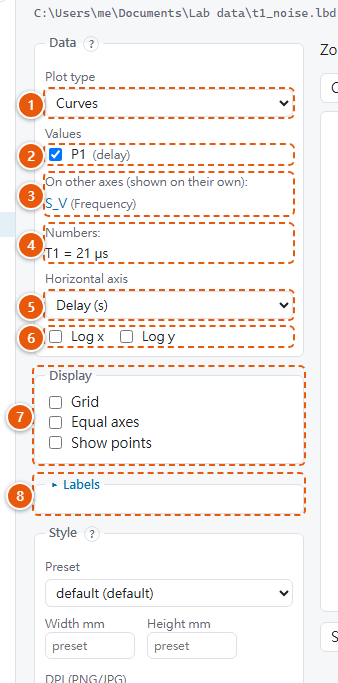
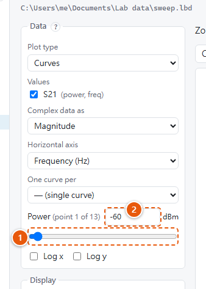
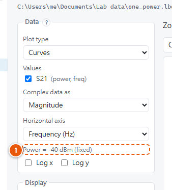

# Plotting

In the **Figure** workspace, double-click a data file to plot it (from Explore: **Open in
Figure**). The controls are on the left and the figure on the right.
Every change redraws the figure straight away. The same settings are available in Python as the
[plot spec](../styles/plot-settings.md) of [`lbd.plot.plot`][lbd.plot.plot].

## The controls

{ width="340" align=right }

1. **Plot type:** **Curves** (lines), **Scatter** (markers) or **Heat map** (a colour map of a
   value with two swept axes).
2. **Values on this axis:** tick several to draw them together, e.g. data and fit.
3. **On other axes:** values measured over another axis, e.g. a noise spectrum over frequency
   next to a decay over delay. Click one to plot it instead, on its own axis.
4. **Numbers:** the file's single numbers (values without axes) with their value, e.g.
   `T1 = 21 µs`. They are listed, not plotted.
5. **Horizontal axis:** which axis runs left to right.
6. **Log x / Log y:** logarithmic axes.
7. **Labels:** a title, and your own axis and colour bar labels.
8. **Style:** the preset, the figure size and DPI, and changes for this file only.

### Data

| Control | Meaning |
|---|---|
| **Plot type** | **Curves** draws lines. **Scatter** draws markers (see [below](#common-tasks)). **Heat map** draws a colour map of a value with at least two axes that have more than one point. **Matrix** draws cells with their numbers, **Bars** bars with labels, and **3D bars** a bar per cell; see [Plot types](explore.md#plot-types) for what each one is for. **Histogram** counts the values: see [below](#histogram). |
| **Value**, **Columns**, **Rows** (Matrix) | Which value and which of its axes; complex values show **Re and Im** side by side, or the usual choices. **Numbers**, **Significant digits**, **Row sums** (each row's sum beside it) and **Colour range** (0 to 1, −1 to 1, Auto) set what the cells show. |
| **Elevation**, **Azimuth** (3D bars) | The angle of the picture, in degrees; **Default angle** brings the style's back. A figure is a picture: there is no dragging here. |
| **Values**, **Groups**, **Bars in a group** (Bars) | What the bars are. **Bars** chooses Grouped or Stacked, **Values on the bars** writes each number at its bar. |
| **Values** (curves, scatter) | Tick several values to draw them together; they share the horizontal axis. **On other axes** lists values measured over another axis; click one to plot it instead. **Numbers** lists the file's single numbers with their value. A single number isn't plotted: there is nothing to draw. A file with only single numbers shows the list instead of a figure. |
| **Value** (heat map, I/Q scatter) | The value to show. Heat maps list values with two swept axes; the I/Q plane lists complex values. |
| **Complex data as** | For complex values: magnitude, magnitude in dB (20·log₁₀), phase in radians or degrees, real part, imaginary part. For scatter also **I/Q plane**: real part against imaginary part, with equal scales. |
| **Horizontal axis** | Which axis runs left to right. For scatter this can also be another **value** with the same axes: the two values are then plotted against each other, point by point. |
| **Vertical axis** | Heat maps: which axis runs bottom to top. |
| **One curve per** | Curves of a 2-D value: one curve per point of this axis, e.g. one curve per power. A short axis gets a legend, a long one a colour bar. Choose **— (single curve)** to draw one curve and pick the other axis's point with a slider instead. |
| **Colour by** | Scatter: colour the points by an axis (e.g. power) or by another value with the same axes. A short axis (e.g. the prepared state) gets one colour per point and a legend; a longer axis or a value gets a colour bar, with the style's fixed scales. |
| **Log x / Log y** | Logarithmic axes. |

**Show points** (curves, under **Display**) puts a small dot, matplotlib's `.` marker, on every
stored point; its size is the style's marker size (`figure.axes.lines.marker_size_pt`), halved.
Its [plot setting](../styles/plot-settings.md) is `points` in `options`.

### Choosing a point on an axis that isn't drawn

{ width="340" align=right }

When a value has more axes than the plot shows, for example a power sweep drawn as a single
curve, you choose which point of the other axis to show:

1. **The slider** steps through the measured points (*point 1 of 13*).
2. **The box** takes the axis value: type `-42` for Power in dBm and press Enter. It goes to the
   nearest measured point (−40 dBm) and shows that point's exact value. A value beyond the axis
   goes to its nearest end, with a note.

On a scatter plot each axis not drawn has a choice: **All of …** ticked, all its points go in; unticked,
it has a slider. A new scatter plot starts with a short axis with named positions as the colours, the
longest axis All and the others sliders. A figure saved before this choice keeps drawing all its points.

A **variable sweep** (an axis group) is drawn as a heat map with its real coordinates: see
[Plot types](explore.md#plot-types). The `options` setting `cells` chooses `rows`, `nearest` or `smooth`.
As curves it is drawn on its real axes too, one curve per outer step: see
[A value as the horizontal axis](explore.md#a-value-as-the-horizontal-axis).

### Fixed parameters

{ width="340" align=right }

An axis with a single point was not swept: one power, one temperature. The viewer treats it as
a fixed parameter:

1. it is shown as e.g. *Power = −40 dBm (fixed)*, without a slider;
2. it is never chosen as the horizontal axis, vertical axis or "one curve per" by itself, so a
   1 × 401 value is drawn as curves, not as a heat map one row high.

You can still pick it explicitly.

### Labels

Open **Labels** to set a title, or to replace the axis and colour bar labels. Units are added
automatically. Changes apply when you leave the field or press Enter. Math is allowed between
dollar signs, e.g. `$|S_{21}|$`.

### Style

| Control | Meaning |
|---|---|
| **Preset** | The style preset for this figure. It starts at the file's own preset if it names one, otherwise the default preset. Edit presets on the [Styles page](styles-page.md). |
| **Width mm / Height mm** | Change the figure size for this file only. Leave empty to use the preset's size. |
| **DPI (PNG/JPG)** | The resolution of PNG and JPG exports for this file (50–2400). Leave empty to use the preset's (Styles page, "PNG / raster resolution"). PDF and SVG are vector files, and the preview doesn't change. |
| **Style changes for this file (JSON)** | Any other [style setting](../styles/settings.md) for this file only, applied on top of the preset. Example: `{"figure": {"font": {"size_pt": 9}}, "quantities": {"S21.db": {"vmin": -20, "vmax": 0}}}`. Press **Apply**. |
| **Annotations (JSON list)** | Lines, text, arrows and shapes drawn on the plot, as matplotlib calls, e.g. `[{"method": "axvline", "args": [7.0], "kwargs": {"ls": ":"}}]`. Press **Apply**. See [Annotations](../styles/plot-settings.md#annotations). |

These changes are not saved until you use **Save this view to the file**
([Saving views](saving-and-exporting.md)).

## Common tasks

| To show | Do this |
|---|---|
| Data and its fit together | Curves; tick both values under **Values**. |
| One curve per power | Curves; **One curve per** → Power. |
| A single power from a sweep | Curves; **One curve per** → — (single curve); then the slider or type the power. |
| A 2-D sweep as a map | Heat map; choose the horizontal and vertical axes. |
| Another value from the same file | Click it under **On other axes**. |
| A decay over many decades of time | **Log x**. A noise spectrum: **Log x** and **Log y**. |
| Measured points against frequency | Scatter; Values = `T1`, Horizontal axis = `freq`. |
| Quadrature against in-phase | Scatter; Values = `Q`, Horizontal axis = `I`. |
| Readout I/Q blobs per prepared state | Scatter; Value = `IQ`, Complex data as = I/Q plane, Colour by = `prep`. |
| Magnitude in dB | **Complex data as** → Magnitude (dB). |

## Scatter

Scatter has the same **Colour by** and **All of …** as Explore, plus **Equal axes**. In Figure, **Colour by** can also
be another value with the same axes. **Histograms beside the plot** adds a histogram of the points in the
figure's limits above and to the right of the plot, on its axes; a legend then goes under the figure. Their
size and opacity are in the style (`figure.axes.scatter`, `sides_size_mm`, `sides_alpha`).

A figure is exact: it always draws its markers, however many (above 5000 they are stored as a picture inside
SVG and PDF files). The points per pixel are only Explore's way of showing very many.

## Histogram

**Histogram** counts how many numbers fall in each bin. It has the controls it has in Explore: **Colour by**
(an outline per step of one axis, or None), **All of …** for each other axis (unticked: a slider), **Bins**
(empty: Auto), **Draw** (Bars or Outline), **Vertical axis** (Count, Fraction or Density) and **Log y**. Values
of the same unit can be ticked together, as outlines. Complex values are counted after **Complex data as**.

A large file is read part by part while the figure is drawn. The bars' opacity and the outlines' width are
in the style (`figure.axes.histogram`). A saved view keeps all of this; a viewer older than this version
says it can't draw the saved view and uses its own default plot.

## What happens when you change the plot type

A file's saved view was made for one plot type. When you choose another type, the values,
complex mode, log scales and title carry over. The axes, series, colours, slider positions,
axis labels and annotations belong to the saved plot, so they start from the new type's
defaults. Likewise, when you choose other values, a saved setting that doesn't fit them is left
out. Neither gives a note: the saved view isn't wrong.

## Notes and errors under the figure

A **yellow note** means the figure was drawn but something was adjusted or ignored. For
example, the file names a style preset that doesn't exist on this computer, its saved view
refers to a value that was removed, or a log scale hides values ≤ 0.

Settings that can't work at all (an index out of range, an unknown axis) show a **red error**
instead.

## Zoom

| Option | Meaning |
|---|---|
| **Fit** | Fits the figure into the window. |
| **100 % (print size)** | Shows the figure at its real printed size on a standard 96 dpi screen. |
| **150 % / 200 %** | Enlarges it. |

The figure's real size in mm is shown next to the zoom box.
