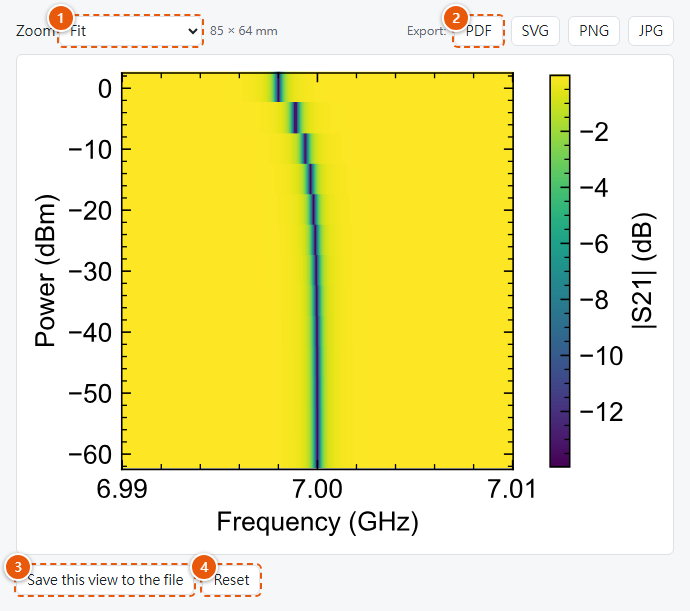

# Saving views and exporting

{ width="560" }

1. **Zoom:** how big the figure is shown here (it doesn't change the exported size).
2. **Export:** PDF, SVG, PNG or JPG, at the figure's real size.
3. **Save this view to the file** stores your plot settings inside the `.lbd` file.
4. **Reset** drops your unsaved changes.

## Saving a view into the file

A *view* is how a file is plotted: the plot settings and the style changes. **Save this view to
the file** stores it inside the `.lbd` file:

- the plot settings (type, values, axes, colour, complex mode, scales, labels, slider positions,
  annotations);
- your style changes for this file (merged with style changes already in the file);
- the chosen preset's name.

From then on the file opens like this everywhere: on any computer with LBD Viewer, for anyone
you send it to, and with `lbd.plot.plot(path)` in Python. **The data itself is never changed.**

| Button | Effect |
|---|---|
| **Reset** | Drops your unsaved changes and goes back to the file's saved view, or to the defaults. |
| **Remove saved view** | Deletes the saved plot settings and style changes from the file. It appears only when the file has some. |

**If the file changed since you opened it** (another program, a Python script, or the viewer
on another computer wrote it), saving asks first:

- **Overwrite** saves your view anyway, replacing the saved view in the file (the data stays);
- **Reload** shows the file as it is now, dropping your unsaved changes;
- **Cancel** keeps your changes, unsaved.

**A view or a preset?** A saved view belongs to one file. A preset (on the
[Styles page](styles-page.md)) is a look shared by many files: size, fonts, colours. Change the
preset to make every figure match, and save a view to fix how one file is shown.

The same can be done from code with [`lbd.set_plot`][lbd.set_plot] (Python), or by setting
`plot`/`style`/`style_name` before saving in any language.

## Exporting

**Export: PDF / SVG / PNG / JPG** saves the figure exactly as shown, at its real size:

- A **Save as** dialog opens in the data file's folder, with the name
  `<file>_<values>.<format>` filled in. Change the folder or name, or cancel.
- The dialog asks before replacing a file, and the name must keep the format's extension.
- On a system without a save dialog (some minimal Linux installs), the figure goes to your
  browser's download folder instead.

See [Exported files](../styles/files-and-export.md#exported-files) for what each format
contains.

| Format | Use it for |
|---|---|
| PDF | Papers, theses, LaTeX: sharp at any zoom, fonts embedded. |
| SVG | Editing in Inkscape or Illustrator, web pages. |
| PNG | Word, PowerPoint, chat and email, at the style's resolution (or the **DPI** set next to Width/Height). |
| JPG | Only when something insists on JPG. It compresses with loss: thin lines and small text get blurred edges, so the viewer shows a short warning after saving. Prefer PNG. |
