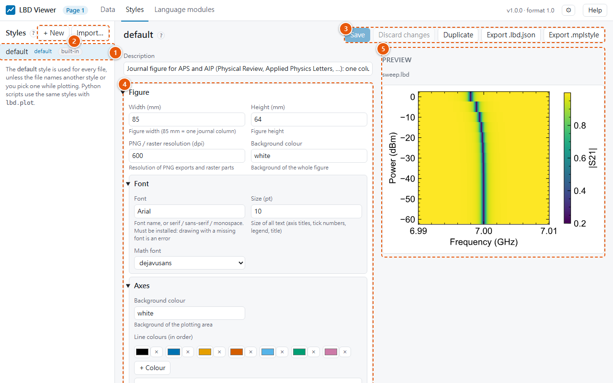

# Styles page

A **preset** is a named look for figures: size, fonts, frame, ticks, colours. Every figure uses
one, so changing a preset changes every figure that uses it. Presets are shared with Python's
`lbd.plot`.

1. **The presets.** **default** marks the default preset; **built-in** marks the presets that
   come with the viewer. Click one to edit it.
2. **+ New** creates a preset, **Import…** adds one from a `.lbd.json` style file.
3. **Save** or **Discard changes**, **Duplicate**, and **Export** as a `.lbd.json` style file or
   a matplotlib `.mplstyle` file.
4. **The settings**, in sections. Click a section title to open or close it.
5. **The preview:** the file open on the Data page, drawn with this preset as you edit it.

Presets decide how every figure looks. The settings are grouped like matplotlib's objects:
**Figure** (size, resolution, font) → **Axes** → **Frame**, **Title**, **Axis** (label, major and
minor ticks), **x axis only / y axis only**, **Grid**, **Legend**, **Lines**, **Scatter
markers**, **Heat maps and colour scales** → **Colour bar**, plus **Fixed scales per quantity**.
Click a section title to open or close it. See the [styles reference](../styles/index.md) for every
setting.

| Action | How |
|---|---|
| Choose a preset to edit | Click it in the list. **default** marks the default preset; **built-in** marks the presets that come with the viewer. |
| Change settings | Edit the form. Empty number fields marked *automatic* follow other settings (e.g. tick width = frame width). The preview on the right shows the result immediately, using the open data file. |
| One axis different | Open **x axis only** or **y axis only**. Empty fields show the shared value they use (*shared*); fill in only what should differ. **Use the shared axis settings again** clears them. |
| Save | **Save** stores the changes; **Discard changes** throws them away. |
| New preset | **+ New**, then type a name. It starts from the built-in defaults. |
| Copy a preset | **Duplicate**, then type a name. The copy includes unsaved changes. |
| Make it the default | **Make default**. The default preset is used for every file that doesn't name another one, and by Python's `lbd.plot` when no style is given. |
| Delete | **Delete** removes one of your presets; files that name it fall back to the default. For built-in presets the button is **Reset** and restores the original settings. |
| Export | **Export .lbd.json** downloads the preset as a [style file](../styles/files-and-export.md#style-files) (the saved version, complete). **Export .mplstyle** downloads matplotlib's own format, for people without LBD; see [matplotlib export](../styles/files-and-export.md#matplotlib-mplstyle-export). |
| Import | **Import…** next to **+ New**: pick a `.lbd.json` file and give it a name. |
| Line colours | Click a colour to change it, **×** to remove it, **+ Colour** to add one. Curves and scatter series use them in order. |
| Fixed scales | **+ Quantity** adds a row: a quantity name (e.g. `temperature`, `S21.db` or an axis such as `freq`), min, max, colour map, linear/log scale and unit prefix (automatic, none, or fixed such as M for MHz). See [fixed scales](../styles/scales-and-units.md#fixed-scales-per-quantity). |
| Edit as JSON | Shows the preset as JSON. Only settings that differ from the built-in defaults are listed. Edit it, then **Apply JSON**. |

Preset names may contain letters, digits, spaces, `_`, `.` and `-`. Presets are shared with
Python: `lbd.plot.load_style("name")` uses exactly the same settings.
